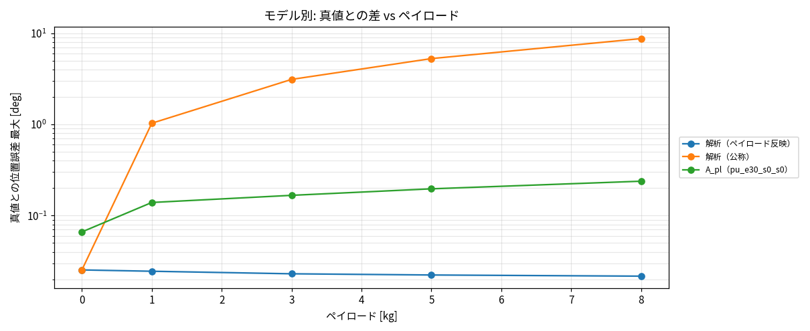

# Phase 4-10: A の軸 1 の誤差の原因調査と改善（#67）

真値 = Simscape 剛体＋摩擦、解析 = 同じ式の RNEA＋摩擦（解析≒真値は実機について何も言わない）。評価は Phase 4-7 の閉ループステップ（2°、ペイロード 0/1/3/5/8 kg × wn 30/60/100/150 × ζ 0.5/1/2、6 軸、360 ケース）。判定は `docs/phase4_8_accuracy_requirements.md` の水準 G。

## 1. 原因

- A_pl の誤差はほぼ軸 1 に集中する（Phase 4-9）。ステップ区間の教師強制解析（`analyze_step_window.py`）で、加速度誤差は軸 1 の高トルク時（|τ|>0.3·TAU_MAX）に出る。
- 学習データに軸 1 の高トルク行がほとんどない（自由運動行のうち 0.086%）。励振が軸 1 の大トルクをほとんど出していなかった。
- 高トルク行のオーバーサンプリング（重み 30/100）では改善しなかった（軸 1 最大 RMS 11.2 → 12.0/12.4 rad/s²）。外挿＝データ欠落が原因で、重みの問題ではない。

## 2. 対策

高トルクのパルス励振シナリオ（`saScenarioSetPulse`、対象軸で重力保持＋BLN 外乱の上に矩形パルスを交互符号で印加、振幅 0.3–1.0·ピークトルク）を 66 本追加（軸 1: 36 本、軸 2–6: 各 6 本、ペイロード 0/1/2/4/6/8 kg を巡回）。計 552 本・3,228,527 遷移。`validateSaData` 合格、解析との 1 ステップ整合の残差比 0.018–0.108。
軸 1 の高トルク行（自由運動）は 1,911 → 4,851 行（約 2.5 倍）。

A_pl は同設定（幅 512・深さ 4・wd 0.2・payload 入力）で、学習時間の都合により 30 エポック（seed 0）。

## 3. 結果

教師強制のステップ区間加速度誤差（RMS 最大、rad/s²）: 軸 1 は 11.20 → 4.88（平均 2.64 → 1.52）。軸 2–6 は 1.0–1.8 で、旧モデル（100 エポック）よりわずかに悪い軸がある（エポック数の差を含む）。

閉ループ 360 ケースの水準 G:

| 指標 | 基準 | 旧 A_pl | 新 A_pl | 解析（ペイロード反映） |
|---|---|---|---|---|
| ステップ区間位置誤差 最大 | ≤0.1° | 0.48° | 0.24° | 0.025° |
| ΔOS 最大 | ≤2 pt | 2.9–3.1 | 3.5 | 0.17 |
| Δ整定 最大 | ≤10% かつ ≤20 ms | 74–104 ms | 104 ms（45%） | 1 ms |
| 最適ゲイン一致 | 全ペイロード | 5/5 | 5/5 | 5/5 |
| 水準 G | | × | × | ○ |

軸別（新 A_pl 最大）: 位置誤差 [deg] 0.238/0.042/0.043/0.067/0.083/0.012、ΔOS [pt] 3.53/1.08/0.67/2.42/1.77/0.00、Δ整定 [ms] 64/104/28/15/51/9（軸 1〜6）。

詳細表: `reports/issue-67/summary.md`。

## 4. 解釈

1. 原因はデータ欠落（高トルク）で、データ追加で軸 1 の位置誤差は半減した。因果の確認になった。
2. ただし水準 G には未達。軸 1 の位置誤差は基準の 2.4 倍、ΔOS は 3.5 pt に悪化し、軸 4 の ΔOS も 2.4 pt で基準超過。小規模（高トルク行 2.5 倍）かつ 30 エポックの結果で、軸 4・5 の悪化はエポック差を含みうる。
3. 最適ゲイン一致 5/5 だが最適 wn がグリッド端（150）の弱い判定。
4. G の達成は引き続き B/解析が担う。実機との差（弾性・減速機）は含まれない。

## 5. 水準 P / 用途 3

PTP 位置決めは本フェーズでは再評価していない。A のステップ区間位置誤差 0.24° は水準 P（関節 0.0013°）に 2 桁以上届かない。用途 3 は B/解析中心とするのが妥当（判断材料）。

## 6. 注意

- 生成は未コミットの作業ツリーで実行したため `manifest.genClean = false`。
- 評価は `eval_payload.py --shard` 4 分割（`data/eval/payload6_pu_s0〜3`）。
- `verify_h5.py` の check.mat 照合は scipy 未導入で未実施。

## 7. 次

パルスを軸 1 中心に 3〜4 倍に拡大して 100 エポック学習し、水準 G を再判定する（別 issue）。
