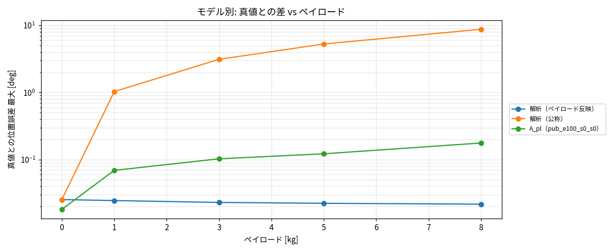

# Phase 4-11: 高トルクパルス励振の拡大と A の水準 G 判定（#69）

真値 = Simscape 剛体＋摩擦、解析 = 同じ式の RNEA＋摩擦（解析≒真値は実機について何も言わない）。評価は Phase 4-7 の閉ループステップ（2°、ペイロード 0/1/3/5/8 kg × wn 30/60/100/150 × ζ 0.5/1/2、6 軸、360 ケース）。判定は `docs/phase4_8_accuracy_requirements.md` の水準 G。

## 1. 実施内容

- Phase 4-10 のパルス励振を拡大: 軸 1 を 36 → 120 本、軸 2–6 を各 6 → 12 本（計 180 本）。全体で 666 本・3,388,127 遷移。`validateSaData` 合格（解析との 1 ステップ整合の残差比 0.023–0.085）。
- 軸 1 の高トルク行（自由運動、|τ|/最大 > 0.3）: 1,911（Phase 4-9）→ 4,851（#67）→ 10,472。
- 不具合と対処: パルス本数を変えると Sobol 列の軸ごとの割り当てがずれ、古いキャッシュと初期状態が重複した（検証 NG、split も不整合）。古い 66 本のキャッシュを削除して再生成し、合格。
- A_pl: 幅 512・深さ 4・wd 0.2・payload 入力、100 エポック、seed 0。

## 2. 結果

教師強制のステップ区間加速度誤差の軸 1 最大 RMS: 11.20（Phase 4-9）→ 4.88（#67）→ **2.05** rad/s²（解析 0.39）。

閉ループ 360 ケースの水準 G:

| 指標 | 基準 | Phase 4-9 | #67 | 今回 | 解析 |
|---|---|---|---|---|---|
| ステップ区間位置誤差 最大 | ≤0.1° | 0.48° | 0.24° | 0.110° | 0.025° |
| ΔOS 最大 | ≤2 pt | 2.9–3.1 | 3.5 | 2.24 | 0.17 |
| Δ整定 最大 | ≤10% かつ ≤20 ms | 74–104 ms | 104 ms | 134 ms（39%） | 1 ms |
| 最適ゲイン一致 | 全て | 5/5 | 5/5 | 5/5 | 5/5 |
| 水準 G | | × | × | × | ○ |

軸別（最大）: 位置誤差 [deg] 0.110/0.042/0.048/0.067/0.092/0.007、ΔOS [pt] 2.24/0.70/1.12/1.67/0.41/0.00、Δ整定 [ms] 134/42/29/15/6/4（軸 1〜6）。

詳細表: `reports/issue-69/summary.md`。

## 3. 解釈

1. データ量に応じて単調に改善（位置誤差 0.48 → 0.24 → 0.11°）。軸 1 の原因が高トルクのデータ不足という結論は強まった。
2. 位置誤差・ΔOS は軸 1 が基準をわずかに超える（0.110° vs 0.1°、2.24 vs 2 pt）のみで、軸 2–6 は基準内。
3. 未達の主因は Δ整定（軸 1: 134 ms、軸 2: 42 ms、軸 3: 29 ms）。整定は整定帯への到達時刻で決まり、減衰のわずかな差が大きく出る指標なので、基準（10% かつ 20 ms）自体の妥当性も検討余地がある。
4. 最適ゲイン一致 5/5 だが最適 wn がグリッド端（150）の弱い判定。
5. 検証 val（自由運動の加速度 RMSE 平均）は 2.63 で Phase 4-9（2.18）より大きい（軸 4・5 が大きい）が、ステップ区間の誤差は小さく、評価上の影響は限定的。
6. 実機との差（弾性・減速機）は含まれない。G の達成は引き続き B/解析が担い、A は参考位置づけを維持。

## 4. 用途 3（位置決め）

A の位置誤差 0.11° は水準 P（関節 0.0013°）に遠く及ばない。用途 3 は B/解析中心の判断を変えない。

## 5. 注意

- 生成は未コミットの作業ツリー由来を含み `manifest.genClean` は false の可能性がある。
- 評価は `eval_payload.py --shard` 4 分割（`data/eval/payload6_pub_s0〜3`）。seed は 1 つのみ。
- 旧データは `data/*_v1` に退避（git 管理外）。

## 6. 次の候補（判断が必要）

- パルスをさらに倍に（軸 1 中心）して再学習し、位置誤差・ΔOS の基準到達を確認。整定は不確か。
- Δ整定の基準の見直し（制振用途に照らして）。
- seed 追加による再現性確認。
- 弾性真値の導入。
