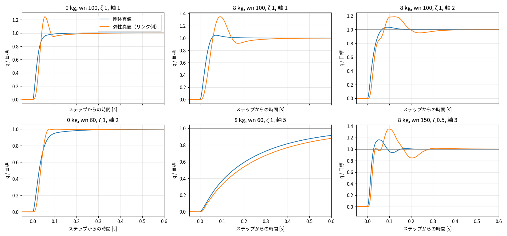

# Phase 4-12: 関節弾性を含む Simscape 真値の導入と剛体モデルとの差の定量化（#71）

真値の実機との対応は未確認で、弾性パラメータは仮の代表値（実機値は未入手）。ここで見るのは「弾性があると剛体の解析・A がどれだけ外れるか」であって、実機の弾性の大きさではない。

## 1. 実装

- 関節弾性: 親資産の armature（RMI 経由の 1-D 慣性、関節に剛結合）を、`RMI のリンク側ノード —[ねじりばね k ∥ ダンパ c]— モータ側ノード（慣性 Jm·N²、理想トルク源が制御トルクを印加）` に置き換えた（`src/plant/addSaElasticArmature.m`、`buildSaPlant` の `opts.elastic`）。親資産は変更していない。
- 制御は PD＋フィードフォワード（Phase 4-7 と同じ）。既定のフィードバックは**モータ側**角度・速度（実機のエンコーダ位置）。評価・比較はリンク側角度 q。モータ側は `qm`, `dqm` として出力。
- 注意点（実測）: RMI のノード回転はリンク側関節角と符号が逆。トルク源とセンサの端子を入れ替えて符号を合わせ、センサ角度の初期値（offset）を q0 に設定した。
- 剛性の決め方（`saElasticParams`）: リンク側慣性 Jl（= Mmean − armature、下限 0.2·armature）とモータ側慣性 Jm の 2 慣性系の固有振動数を 20 Hz にする k を求め、さらに「定格トルクでのねじれ角 ≤ 0.02 rad」になるよう下限を設けた。減衰比 0.05。慣性の小さい手首側が非現実的に柔らかくなる（最初の試行で定格ねじれ 9–21°、軸 5・8 kg で最終値が逆向きになった）ための修正。
  - k = [1.95e4, 2.13e4, 6.35e3, 1.19e3, 1.27e3, 795] N·m/rad、c = [13.1, 17, 3.84, 0.333, 0.299, 0.148]、固有振動数（0 kg）= [23.7, 20, 26.3, 57, 67.7, 85.6] Hz（ペイロードで低下）。
- 検証: k を 1000 倍にした剛体極限で、剛体真値との差は全軸 0.001° 以下（`test/test_sa_elastic.m`、3 軸の閉ループ。パラメータと下限のテストも含む）。

## 2. 結果

同じ 360 ケース（ペイロード 0/1/3/5/8 kg × wn 30/60/100/150 × ζ 0.5/1/2 × 6 軸、2° ステップ）。

### 2.1 弾性真値と剛体真値の差（リンク側 q）

| 軸 | ΔOS 最大 [pt] | Δ整定 最大 [ms] | 弾性の振動成分 最大 [%] | 剛体の振動成分 最大 [%] |
|---|---|---|---|---|
| 1 | 51.7 | 278 | 17.5 | 1.8 |
| 2 | 40.4 | 340 | 15.5 | 2.0 |
| 3 | 22.3 | 245 | 5.9 | 2.3 |
| 4 | 5.9 | 131 | 0.4 | 0.4 |
| 5 | 8.4 | 165 | 0.4 | 0.5 |
| 6 | 0.0 | 60 | 0.5 | 0.4 |

大きな軸（1–3）で OS・整定・振動が大きく変わる。手首（4–6）は剛性の下限により影響が小さい（これは仮定の結果）。

### 2.2 剛体モデル（解析・A_pl）の弾性真値に対する誤差

弾性真値に対し、解析（ペイロード反映）と A_pl（Phase 4-11 の最良）は、どちらもほぼ同じ誤差を示す（剛体モデルは同じ物理）。

| 指標 | 基準（水準 G） | 解析（ペイロード反映） | A_pl |
|---|---|---|---|
| ステップ区間位置誤差 最大 | ≤0.1° | 1.40° | 1.40° |
| ΔOS 最大 | ≤2 pt | 51.9 | 51.8 |
| Δ整定 最大 | ≤10% かつ ≤20 ms | 341 ms | 345 ms |
| 最適ゲイン一致 | 全ペイロード | 0/5 | 0/5 |

最適ゲイン: 真値（弾性）は wn 100/ζ 2（0–3 kg）、wn 60/ζ 2（5–8 kg）。剛体モデルは wn 150 を選ぶ。剛体では高ゲインほど有利になる傾向が、弾性があると成り立たない（Phase 4-7 の指摘どおり）。

### 2.3 感度（ペイロード 8 kg、72 ケース）

| 条件 | 軸 1 ΔOS | 軸 2 ΔOS | 軸 3 ΔOS | 軸 1 Δ整定 | 軸 2 Δ整定 | 軸 3 Δ整定 |
|---|---|---|---|---|---|---|
| 基準 | 45.1 | 29.0 | 20.4 | 278 | 340 | 245 |
| 剛性 ×0.25 | 36.0 | 21.1 | 17.1 | 676 | 664 | 608 |
| 剛性を高く（40 Hz 指定） | 25.0 | 9.9 | 14.2 | 148 | 189 | 132 |
| リンク側 FB（基準剛性） | 4243 | 2088 | 983 | 1125 | 1111 | 1108 |

詳細は `reports/issue-71/sensitivity.md`。

## 3. 解釈

1. 剛体モデルは、弾性があるとゲイン最適化に使えない: 位置誤差 1.4°、ΔOS 50 pt、最適ゲイン 0/5。この結論は剛性を 4 分の 1〜2 倍に振っても変わらない（剛性を高くしても軸 1 の ΔOS は 25 pt、Δ整定は 148 ms で基準に遠い）。
2. A_pl と解析に差がない。Phase 4-11 までに詰めた A の精度（軸 1 の高トルク領域）は、弾性真値に対しては効かない。弾性の誤差が桁違いに大きい。
3. リンク側フィードバック（非コロケーション）では、基準剛性・この PD ゲインで不安定になる（OS が数百〜数千%）。実機のようにモータ側 FB でなければ、真値自体が成立しない。
4. NSM が弾性を扱うには隠れ状態（モータ側角度・速度）が必要。現在の入力（q, dq, τ）のみでは、弾性の振動を 1 ステップでは予測できない（モータ側の状態が観測されない）。再学習の前に、状態の定義（モータ側の角度・速度を追加するか、履歴を入力にするか）を決める必要がある。
5. 手首の影響が小さいのは、剛性の下限（定格ねじれ 0.02 rad）による仮定の結果。実機の剛性に依存する。

## 4. 水準 P / 用途 3

位置決め用途への影響は本フェーズでは評価していない（弾性は残留振動と静的たわみとして位置決めに効く。たわみ τ/k は軸 1 で定格時 0.02 rad ＝ 約 1.1°）。

## 5. 注意

- 剛性・減衰は仮の代表値。実機値が得られたら差し替える（`saElasticParams`）。
- 摩擦は関節側のまま（減速機の損失をモータ側に置く構成は未検討）。
- 評価は `sa_export_payload_eval.m`（`elastic` 引数）で 3 プロセスに分けて生成、`eval_payload.py --data payload_eval6_el20.h5` で 4 分割評価（A_pl は `a_plpu6b`）。
- 弾性真値の HDF5（`data/export/payload_eval6_el*.h5`）は git 管理外。

## 6. 次の候補（判断が必要）

- NSM の状態にモータ側（隠れ状態）を含める設計の検討と、弾性真値でのデータ生成・再学習。
- 弾性の仮定の置き方（手首の剛性、減衰、減速機の摩擦）の見直し・実機値の反映。
- 解析（RNEA）側に関節弾性を入れた解析モデル（2 慣性系）を作り、NSM の比較基準にする。
