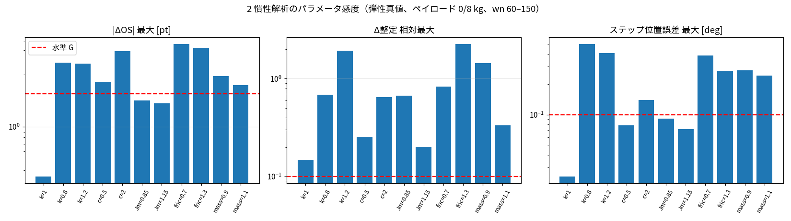

# Phase 4-17: 2 慣性解析モデルのパラメータ感度（issue #81）

## 目的
2 慣性解析（#77, #79）は真値と同一パラメータなので上限値しか分からない。k・c・Jm・摩擦・リンク質量を一つずつずらし、水準 G の指標がどう悪化するかで、同定や残差 NN が吸収すべき誤差の大きさを見積もる。

## 方法
- `TwoMass(scale=…)` で倍率を与える（k, c, Jm, fric＝Fc と Bv, mass＝全リンクの質量・慣性）。真値は変えない。
- 弾性真値のステップ応答（#77 と同じ評価器、`eval_payload_el.py --perturb`）。ペイロード 0・8 kg、wn 60/100/150 × ζ 0.5/1/2（9 ゲイン）、6 軸。
- 計算量のためサブステップは 4（#77 は 8）。基準（倍率 1）も同じ設定で評価した（ΔOS 0.35 pt、Δ整定 8 ms、位置誤差 0.024°）。
- 最適ゲインは、真値・モデルとも上記 9 点のうち OS 最大 ≤ 5% で整定平均が最小のもの。

## 結果
真値の最適ゲイン(wn/ζ): 0 kg → 100/2、8 kg → 60/2
評価ゲイン: wn [60.0, 100.0, 150.0]、ζ [0.5, 1.0, 2.0]（9 点）

| 倍率 | |ΔOS| 最大[pt] | Δ整定 最大[ms] | Δ整定 相対最大 | ステップ位置誤差 最大[deg] | 全区間 q 誤差 最大[deg] | 最適ゲイン一致 | 選択ゲインの整定悪化 | 選択ゲインの真値OS最大[%] | 水準 G |
|---|---|---|---|---|---|---|---|---|---|
| k=1 | 0.35 | 8.0 | 14.8% | 0.024 | 0.024 | 2/2 | 0.0% | 0.00 | ○ |
| k=0.8 | 3.86 | 75.0 | 68.5% | 0.502 | 0.502 | 2/2 | 0.0% | 0.00 | × |
| k=1.2 | 3.76 | 129.0 | 192.5% | 0.407 | 0.407 | 2/2 | 0.0% | 0.00 | × |
| c=0.5 | 2.58 | 59.0 | 25.4% | 0.078 | 0.078 | 2/2 | 0.0% | 0.00 | × |
| c=2 | 4.90 | 87.0 | 64.8% | 0.139 | 0.139 | 2/2 | 0.0% | 0.00 | × |
| Jm=0.85 | 1.73 | 40.0 | 66.7% | 0.092 | 0.092 | 2/2 | 0.0% | 0.00 | × |
| Jm=1.15 | 1.64 | 27.0 | 20.2% | 0.072 | 0.072 | 2/2 | 0.0% | 0.00 | × |
| fric=0.7 | 5.71 | 241.0 | 83.2% | 0.387 | 0.391 | 2/2 | 0.0% | 0.00 | × |
| fric=1.3 | 5.23 | 236.0 | 226.3% | 0.273 | 0.273 | 2/2 | 0.0% | 0.00 | × |
| mass=0.9 | 2.91 | 96.0 | 143.3% | 0.275 | 0.290 | 2/2 | 0.0% | 0.00 | × |
| mass=1.1 | 2.40 | 77.0 | 33.3% | 0.245 | 0.295 | 2/2 | 0.0% | 0.00 | × |

## 読み取り
1. 基準以外は全て水準 G を外れる（ΔOS 1.6〜5.7 pt、位置誤差 0.07〜0.50°）。パラメータは ±10〜50% の誤差でも水準 G を満たさない。
2. 影響が大きい順に、摩擦（±30% で ΔOS 5〜6 pt、整定 240 ms）、c（×2 で 4.9 pt）、k（±20% で約 3.8 pt、位置誤差 0.4〜0.5°）、質量（±10% で 2.4〜2.9 pt）、Jm（±15% で 1.6〜1.7 pt）。
3. 最適ゲインは全変種で真値と一致（選んだゲインの整定悪化 0%）。ゲイン最適化の用途は、ΔOS が数 pt ずれても結論は変わらない。ただし候補は 9 点・2 ペイロードで粗い。
4. 実機の位置決め（P）や ΔOS・整定の絶対値を使う用途では、k と摩擦の同定誤差を 10% 未満にする必要がありそう（線形に外挿した目安で、未測定）。

## 限界
- 一因子ずつの変更。組み合わせ（誤差が打ち消し合う・重なる）は未評価。
- 摩擦は Fc・Bv を同率で変えた。軸ごとに違う誤差、ペイロード質量だけの誤差は未評価。
- ペイロード 0・8 kg、wn 60〜150 のみ。サブステップ 4 の基準誤差（ΔOS 0.35 pt）を含む。
- 水準 G の閾値（ΔOS ≤2 pt）に対する許容倍率は刻みが粗く、数値としては求めていない。

## 次の候補
1. 許容倍率を求める（k・摩擦を ±5/10% で評価）
2. 摩擦・k を同定する手段の検討（学習する残差 NN の入力・出力設計）
3. 残差 NN（B 型）
