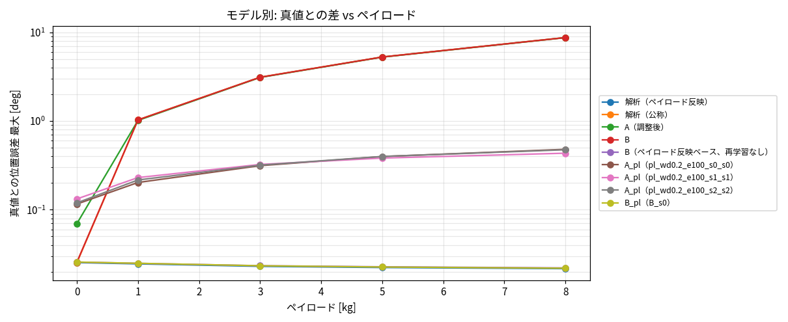

# Phase 4-9: ペイロード入力付きの A/B 再学習と水準 G の判定（#65）

真値 = Simscape 剛体＋摩擦、解析 = 同じ式の RNEA＋摩擦（解析≒真値は実機については何も言わない）。評価は Phase 4-7 の閉ループステップ（2°、手先ペイロード 0/1/3/5/8 kg × wn 30/60/100/150 × ζ 0.5/1/2、6 軸、計 360 ケース）。判定基準は `docs/phase4_8_accuracy_requirements.md` の水準 G。

## 1. 実施内容

| 項目 | 内容 |
|---|---|
| 学習データ | 既存 6 軸データ（0 kg、170 本）＋ペイロード付き複製 316 本（励振・保持シナリオを 2 組複製。ペイロード {1,2,4,6,8} kg を巡回、初期角は反転／巡回シフトで別軌道）。計 486 本・3,136,127 遷移。PTP（benchmark）は 0 kg のみ |
| 検証 | `validateSaData` 合格。解析モデル（ペイロード反映）との 1 ステップ整合の残差比 0.011〜0.084 |
| A_pl | 純 MLP（幅 512・深さ 4・AdamW wd 0.2・100 エポック・加速度表現）、入力に payload/8 を追加。seed 0/1/2 |
| B_pl | 解析ベース（ペイロード反映、遷移ごと）＋ NN 残差。`B_s0`、40 エポック |
| 評価 | 学習ペイロードは 0,1,2,4,6,8 kg。評価点のうち 3・5 kg は未知（補間）、0・1・8 kg は既知 |

学習の val（自由運動の加速度 RMSE 平均）: A_pl s0/s1/s2 = 2.18 / 2.12 / 2.18。B_pl は val 損失の最良 0.591（40 エポック）。

## 2. 結果（水準 G の判定、全 360 ケース）

基準: ΔOS ≤ 2 pt、Δ整定 ≤ 10%（かつ ≤ 20 ms）、ステップ区間位置誤差 ≤ 0.1°、最適ゲインが全ペイロードで一致。

| モデル | ΔOS 最大 [pt] | Δ整定 最大 [ms] | ステップ位置誤差 最大 [deg] | 最適ゲイン一致 | 水準 G |
|---|---|---|---|---|---|
| 解析（ペイロード反映） | 0.17 | 1 | 2.5e-2 | 5/5 | ○ |
| B_pl（再学習） | 0.17 | 1 | 2.6e-2 | 5/5 | ○ |
| B（再学習なし、ベースのみペイロード反映） | 0.18 | 2 | 2.6e-2 | 5/5 | ○ |
| A_pl（seed 0/1/2） | 2.9 / 3.1 / 3.1 | 74 / 74 / 104 | 0.48 / 0.43 / 0.48 | 5/5 | × |
| 解析（公称）・A（0 kg）・B（旧）= ペイロード無視 | 12.0 | 327 | 3.1（最大 8.8 全区間） | 3/5 | × |

- 既知（0/1/8 kg）と未知（3/5 kg）で A_pl の誤差はほぼ同じ（ΔOS 2.9–3.1 vs 1.2–2.7、位置誤差 0.43–0.48 vs 0.38–0.40）。ペイロード方向の補間は問題ではない。
- A_pl の誤差はペイロードとともに増える（全区間位置誤差 0 kg: 0.12° → 8 kg: 0.48°）。0 kg でも 0 kg のみ学習した A（0.07°）より悪い。
- 軸別（A_pl）: ステップ位置誤差・ΔOS を悪化させているのはほぼ **軸 1** のみ（位置 0.43–0.48°、ΔOS 2.9–3.1 pt）。軸 2–6 は位置誤差 0.01–0.07°、ΔOS 0–1.5 pt で基準内。Δ整定は軸 2・3 が 40–100 ms で超過（seed 差あり）。
- 最適ゲイン（OS ≤ 5% のうち整定最小）は A_pl 全 seed で 5/5 一致（ペイロード無視モデルは 3/5）。ただし最適 wn はグリッド端（150）で、Phase 4-7 の指摘どおり弱い基準。

詳細表: `reports/issue-65/summary.md`。

## 3. 解釈

1. **ペイロードを入力に加えるだけで効果は大きい**: ペイロード無視（誤差最大 8.8°、ΔOS 12 pt、最適ゲイン 3/5）→ A_pl（0.48°、ΔOS 3 pt、5/5）。ゲイン最適化の「向き」（最適ゲイン）は A_pl でも正しく選べる。
2. **ただし A_pl は水準 G に届かない**。残る誤差の中心は軸 1（ΔOS・位置）と、軸 2・3 の整定時間。
3. **B は再学習の必要がなかった**: B の NN 残差は小さく B ≒ 解析のため、ベースをペイロード反映にするだけで再学習なしの B と B_pl はほぼ同一（G ○）。したがって G の達成は「B/解析」が担っており、A の NN の貢献ではない。
4. 実機との差（弾性・減速機など）は剛体の真値には含まれない。この表は「剛体真値に対する再現性」であり、制振用途の妥当性は弾性真値で別途確認が必要。

## 4. 水準 P（位置決め）の状況

本フェーズでは PTP の位置決め誤差を再評価していない（P は ±0.03 mm ≒ 関節 0.0013°（最悪ケース）で、ステップ区間の位置誤差 0.43° の A_pl は約 2 桁届かない）。B/解析は Phase 4-8 の評価（PTP ≈ 0.02 mm、余裕小）のまま。A（0 kg）の 0.02–0.06° もペイロード付き再学習で改善していない（0 kg でも 0.12°）。用途 3 を A 中心にするかは、この結果を踏まえて判断が必要。

## 5. 注意（来歴）

- 生成は未コミットの作業ツリーで実行したため、`manifest.genClean = false`（コード差分の来歴ハッシュは記録）。
- HDF5 の `verify_h5.py` は scipy 未導入のため、末尾の check.mat 照合は未実施（行数・統計の照合までは OK）。
- 評価は `eval_payload.py --shard` で 4 分割して実行（`data/eval/payload6_pl_s0〜3`）。

## 6. 次の候補（判断が必要）

- A の軸 1 の誤差の原因調査（軸 1 の入力表現・重み付け、データ量・損失の軸別重み）。
- 水準 G を「B/解析で満たす」と割り切り、A は参考（学習済み NSM の差分用途）に位置づける。
- 弾性真値の導入（制振用途の本命）。
