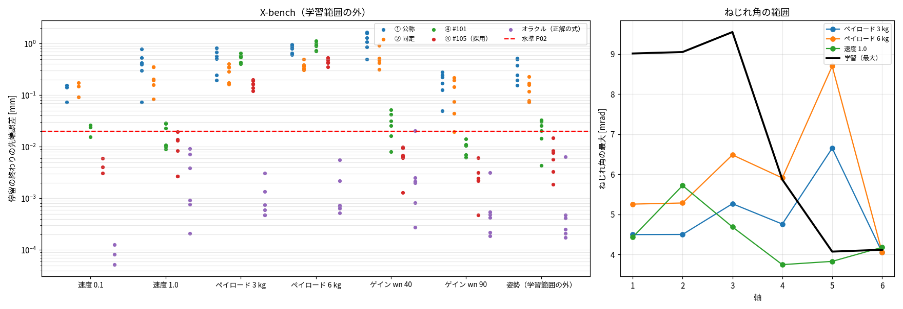

# Phase 5-10: 外挿の評価（X-bench）（issue #107）

#105 の ④（残差 NN: dq を ε で割る＋tanh＋低速の重み、3 つのアンサンブル、sub2・M 凍結）は P-bench v1 で P02 を満たした。P-bench は学習と同じ範囲（速度 0.2〜0.8、ペイロード 0、wn 60、到達点は学習範囲の内側）なので、学習範囲の外で成り立つかを確かめた。

## 方法
- X-bench（`tools/sa_export_xbench.m`）: モデル外の効果入りの Simscape 真値（RelTol 1e-7・AbsTol 1e-9）、PTP 13 本・位置決め 39 回。指標は P-bench と同じ（停留の終わりの先端誤差、フランジから 0.1 m 先）。
  - 速度: 0.1（1 本）、1.0（2 本）。学習は 0.3〜0.9
  - ペイロード: 3・6 kg × 速度 0.5・0.8（4 本）。学習は 0 kg。フィードフォワードはペイロード込み、モデルにもペイロードを与える
  - ゲイン: wn 40・90（各 2 本）。学習は 60
  - 姿勢: 到達点を軸ごとに学習範囲の外側（学習範囲の端〜可動範囲の 5° 手前）から（2 本）
- 比べるモデル: ① 公称、② 同定（Bv≥0）、④ #101、④ #105（採用構成）、オラクル（正解の式、sub2）。① ② ④#101 は sub4・M 凍結。
- 再学習はしない（学習済みのモデルをそのまま使う）。

## 結果

X-bench（モデル外の効果入り真値、PTP・各到達点 0.2 s 停留）の停留の終わりの先端誤差 [mm]。各セルは 中央値 / 最大（≤ 0.02 mm の割合）。学習は速度 0.3〜0.9・ペイロード 0・wn 60・到達点は学習範囲の内側。

| 区分 | 回数 | ① 公称 | ② 同定 | ④ #101 | ④ #105（採用） | オラクル（正解の式） |
|---|---|---|---|---|---|---|
| 速度 0.1 | 3 | 0.1406 / 0.1570（0%） | 0.1469 / 0.1731（0%） | 0.0237 / 0.0261（33%） | 0.0041 / 0.0060（100%） | 0.0001 / 0.0001（100%） |
| 速度 1.0 | 6 | 0.4121 / 0.7880（0%） | 0.2001 / 0.3534（0%） | 0.0169 / 0.0287（50%） | 0.0109 / 0.0194（100%） | 0.0024 / 0.0091（100%） |
| ペイロード 3 kg | 6 | 0.5396 / 0.8287（0%） | 0.3179 / 0.4014（0%） | 0.5596 / 0.6512（0%） | 0.1639 / 0.1984（0%） | 0.0007 / 0.0031（100%） |
| ペイロード 6 kg | 6 | 0.8100 / 0.9533（0%） | 0.3665 / 0.4926（0%） | 0.9119 / 1.1229（0%） | 0.4323 / 0.5295（0%） | 0.0007 / 0.0056（100%） |
| ゲイン wn 40 | 6 | 1.1771 / 1.6716（0%） | 0.4925 / 0.9363（0%） | 0.0286 / 0.0522（33%） | 0.0066 / 0.0099（100%） | 0.0021 / 0.0206（83%） |
| ゲイン wn 90 | 6 | 0.1971 / 0.2789（0%） | 0.1096 / 0.2171（17%） | 0.0106 / 0.0142（100%） | 0.0023 / 0.0060（100%） | 0.0005 / 0.0031（100%） |
| 姿勢（学習範囲の外） | 6 | 0.3116 / 0.5143（0%） | 0.1391 / 0.2267（0%） | 0.0230 / 0.0329（33%） | 0.0067 / 0.0150（100%） | 0.0003 / 0.0063（100%） |
| ペイロード以外の計 | 27 | 0.3032 / 1.6716（0%） | 0.1731 / 0.9363（4%） | 0.0164 / 0.0522（52%） | 0.0060 / 0.0194（100%） | 0.0005 / 0.0206（96%） |

ねじれ角 θ = qm − q の最大 [mrad]（軸 1〜6）:

| データ | 軸 1 | 軸 2 | 軸 3 | 軸 4 | 軸 5 | 軸 6 |
|---|---|---|---|---|---|---|
| 学習（同定・残差 NN） | 9.01 | 9.05 | 9.55 | 5.87 | 4.07 | 4.12 |
| 速度 0.1 | 1.77 | 3.85 | 3.35 | 3.45 | 3.44 | 3.83 |
| 速度 1.0 | 4.43 | 5.72 | 4.69 | 3.75 | 3.83 | 4.18 |
| ペイロード 3 kg | 4.49 | 4.50 | 5.26 | 4.76 | **6.65** | 4.06 |
| ペイロード 6 kg | 5.26 | 5.28 | 6.48 | 5.91 | **8.70** | 4.06 |
| ゲイン wn 40 | 2.55 | 4.25 | 3.48 | 3.46 | 3.55 | 3.88 |
| ゲイン wn 90 | 2.55 | 4.24 | 3.48 | 3.46 | 3.60 | 3.88 |
| 姿勢（学習範囲の外） | 2.01 | 3.88 | 3.53 | 3.52 | 3.60 | 3.88 |

太字: 学習の最大を 5% 超える（ばねの外挿）。

## 読み取り
1. **ペイロード以外では外挿できた。** 速度 0.1・1.0、ゲイン wn 40・90、学習範囲の外の姿勢の 27 回すべてで ④ #105 は ≤ 0.02 mm（最大 0.0194 mm、速度 1.0）。#101 の ④（52%）や ②（4%）より明らかに強い。
2. **ペイロードでは外れる。** 3 kg で最大 0.20 mm、6 kg で 0.53 mm（誤差はほぼ軸 5、0.04〜0.17°）。オラクルは 0.006 mm 以下なので、剛体部分（ペイロードの質量・重心）や計算方法ではなく、**残差 NN のばねの外挿**が原因。ペイロードで軸 5 のねじれ角が 6.7〜8.7 mrad になり、学習の最大 4.1 mrad を大きく超える。#103 の図でも NN の非線形ばねは学習範囲の外で小さすぎた。
3. ② 同定はペイロードでも 0.3〜0.5 mm（P-bench と同程度に外れたまま）。① は全区分で 0.1〜1.7 mm。
4. オラクルが wn 40 で 1 回 0.0206 mm（sub2 の刻みの影響と見られる。sub4 の確認はしていない）。

## 結論と次
- ④ #105 は **速度・ゲイン・姿勢の外挿には強いが、ねじれ角の外挿（ペイロード）には弱い**。ペイロードを変えて使うなら、ばねの残差の外挿を直す必要がある。
- 対策の候補:
  1. 学習データにペイロード（またはねじれ角の大きい保持）を入れる
  2. ばねの残差を外挿しやすい形にする（例: θ の奇数次の多項式など、物理の形を持つ部分を NN の外に出す）
- ③ 純 NN との比較（#107 の当初の候補 2）は、この X-bench をそのまま使える。

## 限界
- 本数が少ない（区分ごとに 1〜4 本、位置決め 3〜9 回）。速度 0.1 は 1 本だけ。
- 真値のモデル外の効果は 2 種類だけ。測定はリンク側も得られる最良の場合。
