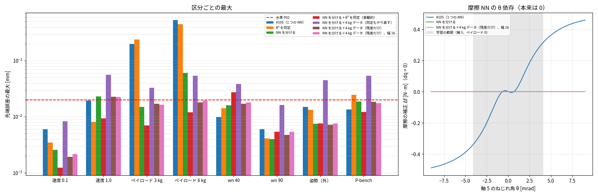

# Phase 5-11: 残差モデルの外挿の改善（issue #109）

#107 で ④ #105 はペイロード 3・6 kg で外れた（最大 0.20・0.53 mm）。当初は「残差 NN のばねの外挿」が原因と見て、ばねを物理の形にする案とデータを足す案を比べた。

## 方法
- θ³ を同定（`identify_el.py --cubic`）: モータ側の式を τ = Jm·ddqm + k·θ + k3·θ³ + c·dθ にする。`TwoMassNB` は `scale.k3` を読む。
- NN を分ける（`fit_residual_el.py --split`）: 軸ごとに、ばねの補正 Δs ← [θ, dθ]、摩擦の補正 Δf ← [dq, tanh(dq/ε)] の 2 つの NN。1 つの MLP（第 1 層・出力層をマスク、第 2 層はブロック対角）にまとめて numba 版がそのまま読む。
- 4 kg データ（`tools/sa_export_xbench.m` で生成）: ペイロード 4 kg の同定用 PTP 4 本（速度 0.3・0.5・0.7・0.9、X-bench と別の到達点）。同定・残差学習はシナリオごとのペイロードで剛体部分を計算する（`identify_el.rigid`）。
- 残差 NN はすべて #105 の設定（dq を ε で割る＋tanh＋低速の重み、3 つの種のアンサンブル）、評価は sub2・M 凍結。X-bench（#107）と P-bench v1。

## 結果

④ ハイブリッド（3 つの種のアンサンブル、sub2・M 凍結）の停留の終わりの先端誤差の**最大** [mm]。X-bench（#107、39 回）の区分ごとと P-bench v1（48 回）。太字なし = ≤ 0.02 mm。

| ④ の残差モデル | 速度 0.1 | 速度 1.0 | ペイロード 3 kg | ペイロード 6 kg | wn 40 | wn 90 | 姿勢（外） | X-bench ≤ 0.02 mm | P-bench 最大 | 1 ms あたり計算時間[ms] |
|---|---|---|---|---|---|---|---|---|---|---|
| #105（1 つの NN） | 0.0060 | 0.0194 | **0.1984** | **0.5295** | 0.0099 | 0.0060 | 0.0150 | 27/39 | 0.0136 | 0.450 |
| θ³ を同定 | 0.0035 | 0.0081 | **0.2380** | **0.4492** | 0.0143 | 0.0041 | 0.0134 | 27/39 | **0.0248** | 0.499 |
| NN を分ける | 0.0026 | **0.0229** | 0.0150 | **0.0609** | 0.0161 | 0.0040 | 0.0075 | 36/39 | 0.0187 | 0.943 |
| NN を分ける＋θ³ を同定（楽観的） | 0.0012 | 0.0093 | 0.0070 | 0.0121 | **0.0275** | 0.0054 | 0.0076 | 38/39 | 0.0122 | 1.050 |
| NN を分ける＋4 kg データ（同定もやり直す） | 0.0083 | **0.0564** | **0.0329** | **0.0538** | **0.0386** | 0.0163 | **0.0449** | 24/39 | **0.0538** | 0.824 |
| NN を分ける＋4 kg データ（残差だけ） | 0.0019 | **0.0228** | 0.0171 | 0.0180 | 0.0171 | 0.0048 | 0.0072 | 38/39 | 0.0186 | 0.809 |
| **NN を分ける＋4 kg データ（残差だけ）、幅 16** | 0.0022 | **0.0225** | 0.0165 | 0.0196 | 0.0181 | 0.0054 | 0.0076 | 38/39 | 0.0176 | 0.461 |

4 kg データ = ペイロード 4 kg の同定用 PTP 4 本（速度 0.3〜0.9）を学習に足す。X-bench のペイロードは 3 kg（内挿）と 6 kg（外挿）。「同定もやり直す」は ② の同定にも 4 kg データを使う、「残差だけ」は ② はペイロードなしの同定のまま、残差 NN の学習にだけ使う。
θ³ を同定: モータ側の式に k3·θ³ を足す。真値のばねがちょうど 3 次式なので k3 は真値と一致し（比 0.999〜1.000）、楽観的。

## 読み取り
1. **原因の見立ての訂正: ばねではなく摩擦 NN の θ 依存だった。** θ³ を同定してばねをほぼ正確にしても、ペイロードは 0.24・0.45 mm のまま。1 つの NN では摩擦の補正 Δf がねじれ角 θ に強く依存していた（図右、dq = 0 でも θ = 8 mrad で 0.45 N·m。物理的には 0）。学習データでは止まっているときの摩擦が姿勢の負荷（= θ）と連動するため、NN がその相関を覚え、ペイロードで θ が学習範囲を超えると補正が膨らんで止まる位置がずれた。#107 の「ばねの外挿」という説明は誤り。
2. **NN を分けると大きく改善**（摩擦の補正は θ に依らなくなる）。ペイロード 6 kg 0.53 → 0.061 mm、3 kg は ≤ 0.02 mm。
3. **4 kg データは残差の学習にだけ使う。** 同定にも使うと、ねじれ角の大きいデータで線形ばねの式が 3 次分を吸収して Jm・c がずれ（Jm 最大 +14%、c 最大 −39%）、全区分で悪化した（P-bench 最大 0.054 mm）。② はペイロードなしの同定のまま、残差 NN にだけ足すと X-bench 38/39、P-bench ≤ 0.02 mm。6 kg（学習の 4 kg の外）も 0.018〜0.020 mm。
4. **幅 16 で速さを保てる。** NN を分けると計算量が約 2 倍（0.8〜0.9 ms）になるが、それぞれの NN を幅 16 にすれば精度は同じで 1 ms あたり 0.46 ms（#105 と同じ）。
5. 残る 1 回は速度 1.0 の 1 か所（0.0225 mm、軸 6）。NN を分けた版で共通して出る。θ³ を同定した版（楽観的）は wn 40 で 1 回外れる（0.0275 mm）。

## 推奨構成（#105 から更新）
④ = ② 同定（ペイロードなしのデータ、Bv≥0）＋ 残差 NN（ばね・摩擦を分ける、各幅 16、dq を ε で割る＋tanh＋低速の重み、ペイロード 4 kg のデータを足す、3 つの種のアンサンブル）、sub2・M 凍結。
X-bench 38/39（最大 0.0225 mm）、P-bench 48/48（最大 0.0176 mm）、1 ms あたり 0.46 ms（逐次で実時間の約 2.2 倍速）。

## 限界
- 4 kg データの到達点は X-bench・P-bench と別だが、ペイロード 4 kg の学習データを足した結果なので、6 kg は「学習の外」ではあっても 0 kg だけのときより外挿の幅は小さい。
- 構成の選択に X-bench・P-bench の結果を使っている（評価データへの合わせ込みが少し入りうる）。
- 真値のモデル外の効果は 2 種類、測定はリンク側も得られる最良の場合。
