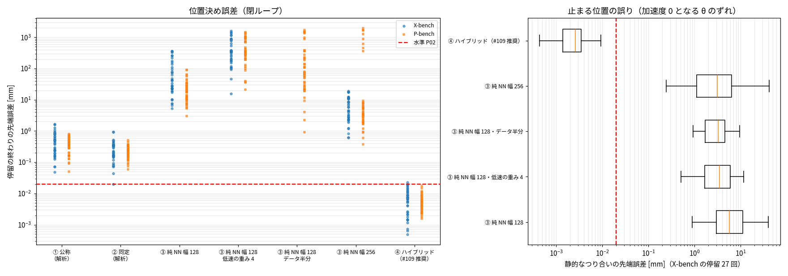

# Phase 5-12: ③ 純 NN との比較（issue #111）

#95 の後で決めた比較の枠組み（① 公称／② 同定／③ 純 NN／④ ハイブリッド）のうち、残っていた ③ を評価した。比べる条件は、④（#109 の推奨構成）と同じ学習データ・同じ積分器・同じ評価（X-bench 39 回、P-bench v1 48 回）。

## 方法
- **③ 純 NN（`python/fit_pure_el.py`）:** 物理の式（M・g・k・Jm・摩擦）を使わない。
  - 入力 [sin q, cos q, dq, θ = qm − q, dθ, τ, ペイロード]（37 列）から、加速度 [ddq, ddqm]（12 列）を出す 6 軸まとめての MLP（2 層 tanh）。
  - 教師の加速度は、8 kHz の真値の角速度の中心差分。
  - 学習データは ④ と同じ 6 ファイル（ペイロード 0 kg と 4 kg、396k 行）。
  - 学習は Adam で 20,000 回（幅 256 は 40,000 回）、バッチ 4096。
- **積分（`python/sa_nsm/pure_nb.py`）:** ④ と同じ ROS2 sub2。
  - ヤコビアンは NN の微分（連鎖律）から作り、1 ms に 1 回だけ計算する。数値微分との相対差は 2e-8。
  - #73 の 1 ms 離散 NN は手首の硬さで発散したため、硬さを陰的積分で吸収する連続時間の形にした。
  - 閉ループ評価器のトルク反復で使うモータ慣性は、NN の ∂ddqm/∂τ の平均の逆数を使う。学習した値は公称の 0.96〜1.3 倍。
- **評価:** `eval_ptp_pos.py --pure`。
- **静的なつり合い（`python/diag_pure.py`）:**
  - X-bench の停留の終わり（ペイロード 0・3・6 kg の 27 回）の真値の状態とトルクで、モデルのリンク側加速度を出す。
  - その加速度が 0 になる θ のずれ δθ（線形化）を求め、q = qm − θ として先端位置の差に換算する。
  - P-bench のファイルには真値のトルクが無いため、X-bench を使った。

## 結果

停留の終わりの先端誤差 [mm]（中央値 / 最大）。

| モデル | X-bench 中央値 / 最大 | X-bench ≤ 0.02 mm | P-bench 中央値 / 最大 | P-bench ≤ 0.02 mm | 静的なつり合いの誤差 中央値 / 最大 | 1 ms あたり計算時間[ms] |
|---|---|---|---|---|---|---|
| ① 公称（解析） | 0.4933 / 1.672 | 0/39 | 0.3974 / 0.8122 | 0/48 | — | 0.153 |
| ② 同定（解析） | 0.2171 / 0.9363 | 1/39 | 0.2224 / 0.5061 | 0/48 | — | 0.159 |
| ③ 純 NN 幅 128 | 41.04 / 367.2 | 0/39 | 18.6 / 90.53 | 0/48 | 5.73 / 39.98 | 0.370 |
| ③ 純 NN 幅 128・低速の重み 4 | 346.5 / 1603 | 0/39 | 341.3 / 1446 | 0/48 | 3.524 / 11.58 | 0.370 |
| ③ 純 NN 幅 128・データ半分 | — | — | 73.9 / 1704 | 0/48 | 3.235 / 9.584 | 0.368 |
| ③ 純 NN 幅 256 | 5.771 / 19.04 | 0/39 | 3.684 / 1959 | 0/48 | 3.147 / 41.72 | 0.977 |
| **④ ハイブリッド（#109 推奨）** | 0.006905 / 0.02254 | 38/39 | 0.004836 / 0.01759 | 48/48 | 0.002585 / 0.009391 | 0.432 |

- ① と ② は sub4、④ は sub2、③ は sub2 で、いずれも M 凍結（③ には M が無く、代わりにヤコビアンを 1 ms に 1 回だけ計算する）。
- 計算時間は numba、逐次 B=1、1 スレッド、3 回測った最小。

加速度の検証データでの相対 RMS（誤差の RMS ÷ 標準偏差）:

| 純 NN | ddq（軸 1〜6） | ddqm（軸 1〜6） |
|---|---|---|
| 幅 128 | 0.27 0.18 0.23 0.29 0.62 0.59 | 0.11〜0.18 |
| 幅 256 | 0.21 0.09 0.11 0.14 0.10 0.45 | 0.06〜0.10 |

## 読み取り
1. **③ 純 NN は P02 から 2〜4 桁外れる。** 最も良い幅 256 でも、学習範囲の内側の P-bench で中央値 3.7 mm です。中央値で比べると ④ より約 750 倍、② より約 17 倍大きい。P-bench には数 m に達する外れもあり、閉ループの途中で発散しかけている。
2. **主な原因は、止まる位置（静的なつり合い）を学べていないこと。**
   - 真値の停留の状態で、③ が出すリンク側加速度は 0 になりません。手首の中央値は軸 5 で 70〜160 rad/s²、軸 6 で 600〜1100 rad/s² です。
   - これを θ のずれに直すと 0.3〜6 mrad で、θ そのもの（標準偏差 1.6〜2.7 mrad）と同じ大きさです。先端では中央値 3〜6 mm になります。
   - ペイロード 0 kg の停留 15 回だけで見ても、幅 256 で中央値 1.1 mm です。
   - ④ は同じ診断で 0.0026 mm です。
3. **P02 に必要な加速度の精度は、いまの純 NN より 2 桁以上細かい。**
   - リンク側の加速度は (k·θ − g(q) − …)/M で、大きな 2 項の差です。
   - 手首の k/Jl は 1.5〜2.4 × 10⁵ s⁻² です。θ の許容誤差を約 2 × 10⁻⁵ rad（#95 の k ±0.4% 相当）とすると、止まっているときの加速度の誤差は 3〜5 rad/s² 以下である必要があります。
   - これは手首の加速度の標準偏差（71・396 rad/s²）の 1〜5%、軸 6 では約 1% にあたります。加えて、学習データの大半を占める運動中ではなく、停留という狭い集合でこの精度が要ります。
   - 線形回帰だけではリンク側の加速度をほとんど説明できず（相対 RMS 0.80〜1.0）、打ち消し合いを当てるのは MLP の仕事になります。
   - ④ では、この打ち消し合いを物理の式（RNEA と k·θ）が受け持ち、NN は 1 N·m 以下の残差だけを学びます。
4. **容量やデータ量を変えても、静的な誤差はほとんど変わらない。**
   - 幅 128 から 256 にすると、加速度の相対 RMS はおよそ半分になり、閉ループの誤差（中央値）も 1/5〜1/7 になりました。しかし静的なつり合いの誤差は中央値 5.7 → 3.1 mm にとどまります。
   - データを半分にしても、静的な誤差は同程度（3.2 mm）でした。
   - 低速の重みを付けると静的な誤差は少し下がりましたが（3.5 mm）、動的な誤差が増えて、閉ループは悪化しました。
   - P02 の 0.02 mm まで、2 桁以上の改善が必要です。今回の範囲（幅・学習回数・データ量・重み）での傾向からは届く見込みが立ちません。
5. **速さの利点もない。** 幅 128 で 1 ms あたり 0.37 ms、幅 256 で 0.98 ms。④（0.43 ms）とほぼ同じか遅い。① ② の解析（0.15 ms）より遅い。物理の式を NN に置き換えても、6 軸の RNEA より軽くはならなかった。

## 結論
同じデータ・同じ積分器・同じ評価で、③ 純 NN は ② 同定にも 1〜2 桁届かず（P-bench 中央値 3.7 mm 対 0.22 mm）、④ ハイブリッドに比べると約 750 倍外れる。計算も速くない。±0.02 mm の位置決めには、静止時のつり合い（重力とばね）を物理の式で持つことが必要で、#95 で決めた「④ が ② より良いこと」でハイブリッドの価値を示すという枠組みは、③ を含めても変わらない（③ < ① < ② < ④）。

## 限界
- ③ は、連続時間の加速度出力・2 層 MLP・幅 256 までで調べた。ほかの形は試していない。
  - 1 ms 離散の NN は #73 で発散している。
  - ロールアウト損失、より深い・広い NN、停留のデータを大量に足すこと、などは未検証。
  - ただし、どれも ④ の速さ（0.43 ms）を保ったまま 2 桁以上改善する必要がある。
- 静的なつり合いの診断は線形化による目安で、閉ループの誤差（動的な誤差や発散を含む）とは一致しない。
- 計算時間は、この 1 台のマシン（4 コア）での値。

## 次
- 測定条件（8 kHz の全状態とトルクが測れるという最良の仮定）を、実機で測れるものに近づける。例えば、リンク側の角度や実トルクが測れない場合。
- ④ の残る 1 回（速度 1.0、軸 6）。
