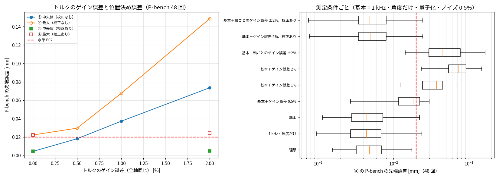

# Phase 5-13: 測定条件を実機に近づけたときの ② / ④ の劣化（issue #113）

④ ハイブリッド（#109 の推奨構成）が P02 を満たしたのは、理想的な測定の条件だった。8 kHz で q・dq・qm・dqm・τ がすべて、ノイズなしで得られる場合である。
本 issue では、同定と残差 NN の学習に使う測定を実機に近づけ、② と ④ をその測定で作り直した。評価はこれまでと同じで、真値（Simscape）に対する X-bench（39 回）と P-bench v1（48 回）の位置決め誤差。

## 方法
- **測定の模擬（`identify_el.py --meas`）。** 8 kHz の真値を加工する。Simscape の再実行は不要。
  - 1 kHz（制御周期）に間引き、角度 q, qm とトルク τ だけを測る。
  - 速度・加速度は、角度の中心差分で求める（平滑化なし）。平滑化の幅 0〜4 サンプルを試したが、同定の k・質量はほとんど変わらず、平滑化すると Jm がずれたため、使わない。
  - 量子化は 4.8e-7 rad（モータ 17 bit/rev × 減速比 100 相当。リンク側も同じとした）。
  - トルクのノイズは、定格トルクの 0.5%（標準偏差、白色）。
  - トルクのゲイン誤差は、測定トルクに 1 + g を掛ける。全軸同じ g = 0.5・1・2% と、軸ごとに ±2% の一様乱数（+0.61, −1.54, +1.80, −0.07, +1.49, −1.15%）の両方を試した。
- **作り直し。** 各条件で次を行った（`fit_residual_el.py --meas`）。
  - ② の同定：ペイロードなしのデータ、Bv ≥ 0。
  - ④ の残差 NN：ばねと摩擦に分けた NN、幅 16、4 kg のデータを残差の学習にだけ使う、3 つの種。
- **トルクのゲイン校正（`calib_gain.py`、`--tcal`）。** 質量が正確に分かっているペイロード 4 kg の運転を使う。
  - まずモータ側の式（θ³ を含む）で Jm を求め、ばねのトルク τs = τ − Jm·ddqm を計算する。
  - 次に、τs ≈ a·rig0 + b·rigP + Bv·dq + Fc·tanh + 摩擦の基底 を軸ごとに最小二乗で解く。rig0 はペイロードなしの剛体トルク、rigP はペイロードの分のトルクである。
  - ペイロードの質量は既知なので、b = 1 + g がゲインの推定値になる。推定した値で τ を割ってから同定と学習を行う。
  - 摩擦の基底は exp(−(dq/(mε))²)·tanh(dq/ε) で、m = 1, 3, 6 とした。真値の Stribeck は m = 2 なので、その形をわざと含めていない。
  - 軸 6 は、ペイロードの重心が軸の上にあってトルクがかからないため、校正できない。補正しないままにした。

## 結果

④ の停留の終わりの先端誤差の**最大** [mm]。太字は 0.02 mm 超。② は同じ測定で同定したもの（sub4・M 凍結）。

| 測定条件 | 速度 0.1 | 速度 1.0 | ペイロード 3 kg | ペイロード 6 kg | wn 40 | wn 90 | 姿勢（外） | ④ X-bench ≤ 0.02 mm | ④ P-bench 中央値 / 最大 | ④ P-bench ≤ 0.02 mm | ② P-bench 中央値 / 最大 |
|---|---|---|---|---|---|---|---|---|---|---|---|
| 理想（8 kHz・全状態・ノイズなし、#109） | 0.0022 | **0.0225** | 0.0165 | 0.0196 | 0.0181 | 0.0054 | 0.0076 | 38/39 | 0.0048 / 0.0176 | 48/48 | — |
| 1 kHz・角度だけ | 0.0027 | **0.0310** | 0.0187 | 0.0167 | **0.0402** | 0.0018 | 0.0119 | 36/39 | 0.0044 / **0.0239** | 47/48 | 0.223 / 0.509 |
| 基本（＋量子化・トルクのノイズ 0.5%） | 0.0038 | **0.0294** | 0.0196 | 0.0143 | **0.0434** | 0.0030 | 0.0123 | 36/39 | 0.0045 / **0.0222** | 47/48 | 0.223 / 0.509 |
| 基本＋ゲイン誤差 0.5% | **0.0206** | **0.0328** | **0.0357** | **0.0705** | **0.0757** | 0.0103 | 0.0167 | 21/39 | 0.0182 / **0.0297** | 30/48 | 0.212 / 0.494 |
| 基本＋ゲイン誤差 1% | **0.0375** | **0.0623** | **0.0841** | **0.1478** | **0.1528** | 0.0192 | **0.0323** | 12/39 | 0.0373 / **0.0676** | 9/48 | 0.208 / 0.479 |
| 基本＋ゲイン誤差 2% | **0.0713** | **0.1215** | **0.1877** | **0.3034** | **0.3082** | **0.0372** | **0.0637** | 4/39 | 0.0736 / **0.1486** | 0/48 | 0.202 / 0.449 |
| 基本＋軸ごとのゲイン誤差 ±2% | **0.0396** | **0.1021** | **0.1209** | **0.1711** | **0.2429** | **0.0398** | **0.1125** | 5/39 | 0.0444 / **0.1646** | 4/48 | 0.231 / 0.494 |
| 基本＋ゲイン誤差 2%、校正あり | 0.0030 | **0.0317** | **0.0259** | **0.0214** | **0.0493** | 0.0028 | 0.0124 | 34/39 | 0.0049 / **0.0246** | 46/48 | 0.225 / 0.510 |
| 基本＋軸ごとのゲイン誤差 ±2%、校正あり | 0.0030 | **0.0316** | **0.0257** | **0.0212** | **0.0492** | 0.0027 | 0.0124 | 34/39 | 0.0049 / **0.0245** | 46/48 | 0.225 / 0.510 |

ゲイン校正の推定誤差（推定した g − 与えた g、軸 1〜5）:

| 与えたゲイン誤差 | 推定の誤差 |
|---|---|
| 0 | −0.10〜+0.08% |
| 全軸 1% | −0.10〜+0.08% |
| 全軸 2% | −0.10〜+0.08% |
| 軸ごと ±2% | −0.09〜+0.08% |

校正の方法による違い（与えたゲイン誤差 0、理想の測定）:

| 校正の方法 | 推定の偏り（最大） |
|---|---|
| Jm を線形ばねで求め、摩擦の基底なし | −2.3%（軸 1） |
| θ³ を入れて Jm を求める | −1.4%（軸 1）、+1.4%（軸 4） |
| θ³ ＋ 摩擦の基底（m = 1, 3, 6） | 0.1% 以下 |

## 読み取り
1. **P02 を失う主な要素は、トルクのゲイン誤差。**
   - 誤差はゲイン誤差にほぼ比例して増える。P-bench の中央値は、0.5% で 0.018 mm、1% で 0.037 mm、2% で 0.074 mm になった。0.5% で、すでに 48 回中 18 回が 0.02 mm を超える。
   - 仕組み：測定トルクが 1 + g 倍なら、同定値（k・Jm・c・質量・摩擦）も残差 NN も、すべて 1 + g 倍になる。一方、閉ループでモデルに入る指令トルクは正しい。そのため、止まっているときに重力の g 倍だけトルクが足りず、PD がその分を位置のずれで補う（g·τ重力/Kp）。
   - ゲインの低い wn 40 と、重力トルクの大きいペイロード 6 kg で最も悪いのは、この仕組みと一致する。
   - 実機のトルク定数の誤差は数% あるのが普通なので、校正なしでは P02 に届かない。
2. **② はゲイン誤差にほとんど反応しない（0.20〜0.23 mm）。** ② の誤差は、式にない効果（硬化ばね、Stribeck）による 0.2 mm が大半で、ゲイン誤差による分（2% で 0.07 mm 程度）はそれに埋もれる。ゲイン誤差が問題になるのは、④ のように精度が P02 の水準まで来たときである。
3. **質量既知のペイロードによる校正で、ほぼ取り戻せる。**
   - ゲイン誤差 2%（全軸同じ）でも軸ごと ±2% でも、校正後は軸 1〜5 の推定誤差が 0.1% 以下になった。
   - ④ の P-bench は、中央値 0.0049 mm、最大 0.0245 mm、46/48 まで戻った。ゲイン誤差のない「基本」の 0.0045 / 0.0222 mm、47/48 とほぼ同じである。
   - 校正には、モータ側に θ³ を入れることと、摩擦の基底（Stribeck を表せる形）が必要だった。どちらかを欠くと、ゲイン誤差 0 でも 1〜2% の偏りが出て、校正しないのと同じくらい悪い。
   - 軸 6 は校正できないが、補正なしで ±1〜2% のゲイン誤差が残っても、結果はほぼ同じだった（全軸 2% と軸ごと ±2% で同じ値）。軸 6 は重力トルクがかからないため、止まる位置に効かない。
4. **1 kHz・角度だけでも、少し劣化する（P-bench 47/48、X-bench 36/39）。**
   - 原因は、動的なパラメータのずれ。1 kHz の差分では、手首の振動（固有振動数 57〜86 Hz）の速度・加速度が小さく出る（85 Hz で約 9%）。そのため、軸 5・6 の減衰 c が 36〜64% 小さく、Jm が 1〜3% 大きく同定された。k・質量・Fc の変化は 0.6% 以下だった。
   - 外れたのは、軸 6 の速い動作（速度 0.8〜1.0）と、ゲインの低い wn 40 の軸 5（0.040 mm）。どちらも、止まりきる前の振動の残りが効いている。
   - 量子化（4.8e-7 rad）とトルクのノイズ（0.5%）は、ほとんど影響しなかった。最小二乗と NN の学習でならされる。

## 結論
- 実機に近い測定（1 kHz、角度とトルクだけ、量子化、ノイズ）でも、④ は P02 の境目付近（P-bench 最大 0.022〜0.025 mm、46〜47/48）を保てる。
- ただしそれには、トルクのゲイン誤差を 0.1% 程度まで校正することが必須である。質量既知の重りを付けた運転から推定する方法で、それができることを模擬で示した。
- 残る劣化は、1 kHz の差分による減衰 c のずれで、wn 40 と速い動作に出る。

## 限界
- リンク側の角度 q は、まだ測れる前提である。実機ではモータ側のエンコーダだけのことが多く、その場合は θ = qm − q が直接得られない。今の同定法はそのままでは使えない。
- ゲイン誤差は、時間で変わらない一定の倍率とした。温度による変化、トルクのリップル、摩擦の温度依存などは模擬していない。
- 校正の摩擦の基底には、真値の形（m = 2）を含めていない。それでも、真値の Stribeck と同じ族（exp·tanh）の関数なので、楽観的な面がある。
- 校正に使ったペイロードの質量は誤差 0 とした。実際には、質量の誤差（例：4 kg ± 1 g = 0.025%）がそのままゲインの誤差になる。
- 量子化の刻みやトルクのノイズの大きさは、仮定の値である（実機の仕様は未確認）。

## 次
- リンク側の角度なし（モータ側だけ）での同定。例えば、レーザートラッカーで静止時の手先を測る、加速度計を使う、など。
- 1 kHz での減衰 c のずれへの対策。例えば、差分による減衰を補正する、または c を時間領域のシミュレーション誤差で合わせる。
