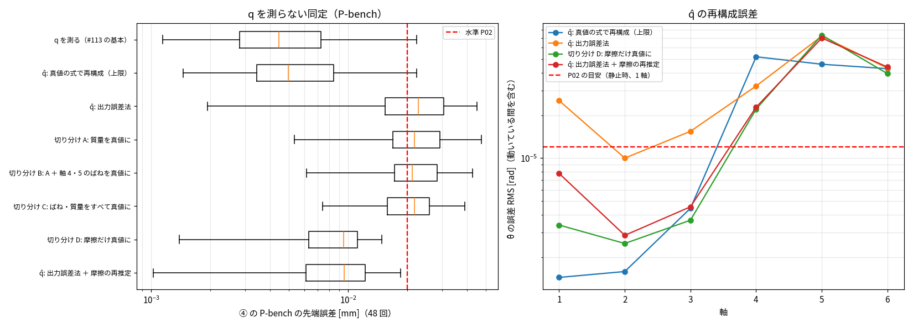

# Phase 5-14: リンク側の角度なし（モータ側だけ）での同定（issue #115）

#113 までは、リンク側の角度 q が測れる前提で同定していた（θ = qm − q をそのまま使う）。実機では、モータ側のエンコーダ（qm）とトルク（電流）しか無いことが多い。
本 issue では、**q を測らずに** ② の式のパラメータと ④ の残差 NN を作り、P02 にどこまで届くかを調べた。測定は #113 の「基本」（1 kHz、量子化 4.8e-7 rad、トルクのノイズ 0.5%）で、トルクのゲインは校正済み（誤差なし）とした。評価はこれまでと同じで、真値（Simscape）に対する X-bench（39 回）と P-bench v1（48 回）の位置決め誤差。

## 難しさ
- 止まっているとき τ = k·θ = g(q) なので、k が違っても θ = g/k で辻褄が合う。静的なデータだけでは k が決まらない。
- 一方、P02 には k が約 ±0.4% の精度で要る（#95）。k は動的な応答（ばねの共振）から決めるしかない。

## 方法
1. **リンク側の状態の再構成（`sa_nsm/linkobs_nb.py`）。** 測った qm を入力にして、リンク側（剛体＋ばね＋摩擦）だけを模擬し、q̂, dq̂ を作る。
   - リンク側はばねで qm につながっているので、模擬は発散せず、誤差も積み上がらない。
   - 積分は ROS2 で、1 ms を 16 サブステップに分ける。qm は 1 ms の中で 3 次エルミート補間する。
   - 真値の式とパラメータを与えると、軸 1〜3 の θ̂ の誤差は 1〜4e-6 rad（θ の約 0.1%）。手首（4〜6）は 4〜5e-5 rad で、これ以上は下がらなかった。摩擦が支配的で動きが敏感なためで、8 kHz の厳密なデータでも同じ程度だった。
   - サブステップ 4 では、軸 6 の誤差が 5e-4 rad と大きかった。サブステップを増やしても、計算時間はほとんど増えない（M は 1 ms に 1 回）。
2. **出力誤差法（`recon_link.py fit`）。** 再構成した θ̂ から予測したトルク τ̂ = Jm·ddqm + k·θ̂ + k3·θ̂³ + c·dθ̂ と、測ったトルクの差（定格で割る）を最小にする。
   - Jm は毎回、最小二乗で消す。
   - 残る 49 個（k, k3, c, 質量倍率 s, Bv, Fc, 摩擦の基底 m = 1, 3, 6 の係数）を Levenberg–Marquardt で解く。ヤコビアンは差分で求め、刻みは 2e-3、計算はプロセス 4 つで並列にした。
   - 各シナリオの始めの 0.5 s は損失に入れない。真値の初期状態（θ = 0 から垂れ下がる過渡）は実機には無いため。
   - 初期値は、真値から k 0.9 倍、c 1.5 倍、質量 0.97 倍、摩擦 0.8 倍にずらした。
   - データは、ペイロードなしの同定データ（27 シナリオ、160 秒）。12 回の反復で収束した（1 回 12〜15 分）。
3. **摩擦の再推定（`recon_link.py refric`）。** 出力誤差法のあと、摩擦だけを式の誤差で推定し直す。
   - ばねのトルク τs = τ − Jm·ddqm は測定から決まり、q̂ によらない。
   - リンク側の式 τs = s·(M(q̂)·ddq̂ + g + b) + 摩擦(dq̂) は、q̂ の小さな誤差にほとんど影響されない。
   - そこで、細かい基底（m = 0.5, 1, 1.5, 2.5, 3, 4, 6, 10。真値の m = 2 は含めない）で摩擦を最小二乗で解き、q̂ を作り直す。これを 10 回繰り返した。
4. **④ の作り直し。** 再構成した q̂（ペイロード 4 kg のデータも含む）を q の代わりに使い（`identify_el.py --qhat`、`fit_residual_el.py --qhat`）、#109 の構成で ② の同定と ④ の学習を行った。
   - ばねと摩擦の NN、幅 16、3 つの種。
   - 4 kg のデータは残差の学習にだけ使う。

## 見込みの確認（k の谷）
真値の式から、軸 i の k（と k3）だけを倍率 0.97〜1.03 で変え、損失（その軸の分）を見た（`recon_link.py scan`、サブステップ 16）。
- 軸 1〜4・6: 谷の最小が 0.99〜1.00 にあった。軸 1・2 は鋭く、1% ずらすと損失がノイズの水準の 2〜3% 増える。データ量から見ると、k を 0.1% より細かく決められる。
- 軸 5: 谷がぎざぎざで（±1% の範囲に凹凸）、最小が定まらない。手首の摩擦で、動きが k の小さな変化に敏感なため。

## 結果

④ の停留の終わりの先端誤差の**最大** [mm]。太字は 0.02 mm 超。

| 条件 | 速度 0.1 | 速度 1.0 | ペイロード 3 kg | ペイロード 6 kg | wn 40 | wn 90 | 姿勢（外） | X-bench ≤ 0.02 mm | P-bench 中央値 / 最大 | P-bench ≤ 0.02 mm |
|---|---|---|---|---|---|---|---|---|---|---|
| q を測る（#113 の基本） | 0.0038 | **0.0294** | 0.0196 | 0.0143 | **0.0434** | 0.0030 | 0.0123 | 36/39 | 0.0045 / **0.0222** | 47/48 |
| q̂: 真値の式で再構成（上限） | 0.0040 | **0.0275** | **0.0203** | 0.0156 | **0.0595** | 0.0036 | 0.0158 | 35/39 | 0.0050 / **0.0223** | 46/48 |
| q̂: 出力誤差法 | 0.0168 | **0.0371** | **0.0352** | **0.0348** | **0.0661** | **0.0271** | **0.0237** | 14/39 | 0.0228 / **0.0451** | 20/48 |
| 切り分け A: 質量を真値に | 0.0137 | **0.0375** | **0.0362** | **0.0368** | **0.0654** | **0.0268** | **0.0248** | 15/39 | 0.0217 / **0.0476** | 19/48 |
| 切り分け B: A ＋ 軸 4・5 のばねを真値に | 0.0130 | **0.0292** | **0.0422** | **0.0439** | **0.0529** | **0.0237** | **0.0234** | 15/39 | 0.0212 / **0.0428** | 21/48 |
| 切り分け C: ばね・質量をすべて真値に | 0.0151 | **0.0279** | **0.0392** | **0.0391** | **0.0511** | **0.0216** | **0.0223** | 16/39 | 0.0217 / **0.0391** | 21/48 |
| 切り分け D: 摩擦だけ真値に | 0.0072 | **0.0339** | 0.0141 | **0.0429** | **0.0512** | 0.0113 | 0.0105 | 35/39 | 0.0095 / 0.0148 | 48/48 |
| **q̂: 出力誤差法 ＋ 摩擦の再推定** | 0.0062 | **0.0355** | 0.0139 | **0.0378** | **0.0579** | 0.0142 | 0.0130 | 34/39 | 0.0095 / 0.0185 | **48/48** |

q̂ の再構成誤差（θ̂ − θ の RMS。動いている間を含む全シナリオで、始めの 0.5 s を除く） [rad]:

| 再構成 | 軸 1 | 軸 2 | 軸 3 | 軸 4 | 軸 5 | 軸 6 |
|---|---|---|---|---|---|---|
| 真値の式（上限） | 1.4e-06 | 1.6e-06 | 4.4e-06 | 5.2e-05 | 4.6e-05 | 4.3e-05 |
| 出力誤差法 | 2.5e-05 | 1.0e-05 | 1.5e-05 | 3.2e-05 | 7.2e-05 | 4.3e-05 |
| 出力誤差法 ＋ 摩擦の再推定 | 7.8e-06 | 2.9e-06 | 4.5e-06 | 2.3e-05 | 7.0e-05 | 4.4e-05 |
| （参考）θ の RMS | 1.6e-03 | 2.4e-03 | 2.4e-03 | 2.5e-03 | 2.3e-03 | 2.5e-03 |

出力誤差法の推定値（真値に対する比）:

| 量 | 軸 1 | 軸 2 | 軸 3 | 軸 4 | 軸 5 | 軸 6 |
|---|---|---|---|---|---|---|
| k | 0.9981 | 1.0025 | 1.0000 | 0.9880 | 0.9819 | 1.0039 |
| k3 | 1.031 | 1.003 | 1.006 | 1.025 | 0.930 | 0.958 |
| c | 0.996 | 0.991 | 1.005 | 2.598 | 3.897 | 1.835 |
| Jm | 0.9985 | 0.9972 | 1.0006 | 0.9437 | 0.8850 | 0.9821 |
| 静止時の θ の誤差（θ = 0.0015 rad） | +0.09% | −0.24% | −0.01% | +1.06% | +1.89% | −0.25% |
| 静止時の θ の誤差（θ = 0.003 rad） | −0.11% | −0.21% | −0.05% | +0.71% | +1.99% | +0.05% |

質量の倍率は 1.0021（+0.21%）。ただし、q̂ から ② を同定し直すと、質量は 0.9991 になった（q を測った場合 0.9992）。

## 読み取り
1. **q を測らなくても、④ は P02 を満たせた（P-bench 48/48、最大 0.0185 mm）。** 方法は、qm を入力にリンク側を模擬して q̂ を作り、出力誤差法でパラメータを推定し、摩擦を推定し直す、という流れ。X-bench は 34/39 で、q を測った場合（36/39）に近い。
2. **q̂ を作ってから同定する、というやり方自体は成り立つ。** 真値の式で作った q̂ を使うと、④ は q を測った場合とほぼ同じになる（46/48・47/48、中央値 0.0050・0.0045 mm）。q̂ の誤差が動いている間に手首で 5e-5 rad あっても、④ にはほとんど効かない。
3. **k は、動的な応答から決まる。** 出力誤差法で、腕の 3 軸の k は真値の ±0.25% 以内、c も ±1% 以内に入った。初期値を 10% ずらしても、そこへ収束した。手首は c が 2〜4 倍に外れたが、c は位置決めにはほとんど効かない（#95）。
4. **出力誤差法だけでは、P02 に届かなかった（20/48）。原因は摩擦の形。**
   - 切り分けると、質量（A）、手首のばね（B）、ばね全体（C）を真値にしても戻らない。摩擦だけを真値にすると（D）48/48 に戻る。
   - 基底（m = 1, 3, 6）では、真値の Stribeck（m = 2）を表しきれず、Fc の約 2%（軸 1 で 0.7 N·m）のうねりが残った。それが、動いている間の θ̂ のずれ（軸 1 で 2.5e-5 rad ≒ 0.7 / k）になり、残差 NN の学習に移った。
   - 損失はトルクの誤差で測っているので、摩擦の形の小さな誤差は、損失にはほとんど現れない（真値より小さい損失まで下がった）。
5. **摩擦の再推定で、ほぼ戻った。** ばねのトルクは測定から分かり、リンク側の式は q̂ の小さな誤差に影響されにくい。そのため、式の誤差で摩擦を解き直すと、真値の形に近づく。軸 1〜3 の q̂ の誤差は 2.5e-5 から 3〜8e-6 rad に下がり、摩擦を真値にした場合（D）と同じ水準になった。
6. **残る差は、中央値（0.0095 mm）。** q を測った場合（0.0045 mm）の約 2 倍で、D と同じ値。出力誤差法のばねの推定（特に軸 5 の静止時の θ が約 +2%、軸 4 が約 +1%）が効いていると見られる。軸 5 は損失の谷がぎざぎざで、k が定まりにくい。

## 結論
- モータ側のエンコーダとトルクだけでも、出力誤差法（リンク側の模擬）と摩擦の再推定で、④ は P-bench の P02（48/48）を満たした。
- 腕の 3 軸の k は、動的な応答から真値の ±0.25% 以内で決まる。
- 弱いのは手首、特に軸 5 の静的なばねで、約 2% ずれる。中央値が q を測った場合の 2 倍になったのは、これが原因と見られる。

## 限界
- 真値の硬化ばねは 3 次式（k·θ·(1 + a·(θ/θr)²)）で、同定の式（k·θ + k3·θ³）と同じ形。ばねの形が違う場合は試していない。
- 摩擦の基底は真値と同じ族（exp·tanh）。真値の幅（m = 2）は含めていないが、近い幅（1.5, 2.5）を含むので、楽観的な面がある。
- 模擬の初期状態は、真値と同じ「θ = 0、静止」とした。実機では、静止時のつり合いを解いて決めることになる。
- 出力誤差法は、初期値 1 つ、データ 1 組で試しただけ。初期値への依存や、ばらつきは調べていない。計算は約 3 時間（4 プロセス）。
- トルクのゲインは校正済み（誤差なし）とした。#113 の校正は q を使う（rig の計算に q を使う）ので、q なしでの校正は別に要る。
- 外部の測定（レーザートラッカーなど）は使わなかった。手首の静的なばねを補うには有効かもしれない。

## 次
- 軸 5 の静的なばねの精度を上げる。例えば、手首を大きく動かすデータを足す、静止時の手先位置の外部測定を足す。
- q なしでのトルクのゲインの校正（#113 の校正と出力誤差法を組み合わせる）。
- 出力誤差法の初期値への依存の確認。
