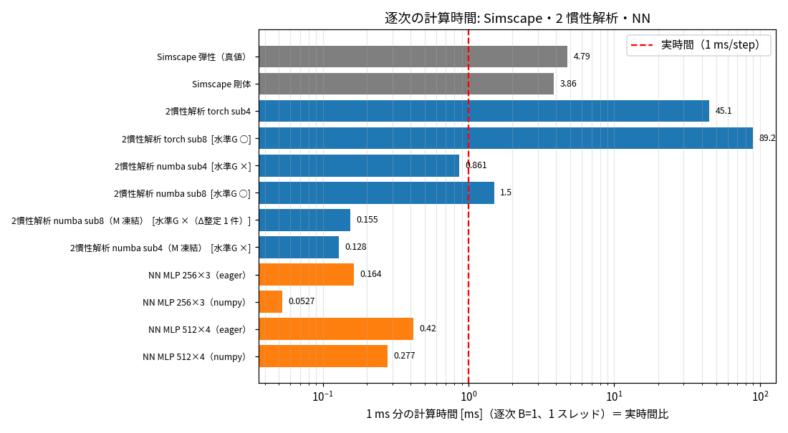

# Phase 5-2: 速度の計測基盤（逐次の実時間比）（issue #91）

## 方法
- 逐次（B=1、1 スレッド）で、1 ms 分のプラント 1 ステップの計算時間を測る。実時間比 = 計算時間 ÷ 1 ms（1 未満なら実時間より速い）。
- Simscape: `tools/sa_bench_simscape.m`（`-singleCompThread`）。G-bench v1 と同じステップ応答（1.8 s、ペイロード 0 kg、wn 100・ζ 2）。構築と初回 sim を除いた 2 回目以降の sim の最小時間。
- Python: `python/bench_speed_el.py`。状態を進めながら連続実行した平均を 5 回測り最小値。
- 2 慣性解析の numba 版（`python/sa_nsm/twomass_nb.py`、ユーザー了承で numba を導入）: torch 版と同じ式・同じ ROS2。小さい行列演算（3×3 積、LU 分解）を手で書いた（numba の linalg は scipy を要する）。torch 版との差は 1e-12 以下。
  - 「M 凍結」: 質量行列 M(q) と g+b を 1 ms の始点で 1 回だけ計算し、サブステップ内で使い回す（RNEA を 1 ms あたり 120 回 → 8 回）。
- NN: A_el と同じ入出力（37 → 24）の MLP。torch eager（no_grad）と、同じ重みを numpy で計算したもの。
- 閉ループで PD 反復（iters=1）を使うとプラントを 1 ms に 2 回呼ぶので、その場合は 2 倍になる（表は 1 回分）。
- 計測時の負荷: 別ユーザーのプロセスで load average 1〜2（4 コア）。

## 結果

| モデル | ms / 1 ms | 実時間比 | 水準 G（G-bench v1） |
|---|---|---|---|
| Simscape 弾性（真値） | 4.79 | 4.8 | （真値） |
| Simscape 剛体 | 3.86 | 3.9 | — |
| 2 慣性解析 torch、サブステップ 8 | 89.2 | 89 | ○ |
| 2 慣性解析 numba、サブステップ 8 | 1.50 | 1.5 | ○（torch 版と同値） |
| 2 慣性解析 numba、サブステップ 8、M 凍結 | 0.155 | 0.16 | ×（Δ整定の 1 件のみ） |
| 2 慣性解析 numba、サブステップ 4 | 0.861 | 0.86 | × |
| 2 慣性解析 numba、サブステップ 4、M 凍結 | 0.128 | 0.13 | × |
| NN 256×3（torch） | 0.164 | 0.16 | （未学習） |
| NN 256×3（numpy） | 0.053 | 0.05 | （未学習） |
| NN 512×4（torch） | 0.420 | 0.42 | （未学習） |
| NN 512×4（numpy） | 0.277 | 0.28 | （未学習） |

numba 版の G-bench v1（`reports/issue-91/summary.md`）:

| モデル | ΔOS 最大[pt] | Δ整定 最大[ms] | Δ整定 相対最大 | 位置誤差 最大[deg] | 選択ゲインの整定悪化 | 水準 G |
|---|---|---|---|---|---|---|
| numba sub8 | 0.06 | 2 | 3.7% | 0.023 | 0% | ○ |
| numba sub8（M 凍結） | 0.08 | 50 | 75.8% | 0.023 | 0% | × |
| numba sub4（M 凍結） | 0.35 | 8 | 14.8% | 0.025 | 0% | × |
| numba sub4 | 0.35 | 8 | 14.8% | 0.024 | 0% | × |

- M 凍結の × は 1 件（1 kg、wn 150・ζ 2、軸 3）だけ: 真値の整定 66 ms に対し 116 ms。OS は両方 0%、位置誤差 0.002°。応答の尾が ±2% の帯の境界をかすめるかどうかで整定時間が飛ぶ（整定時間は不連続な指標）。他の 359 ケースの Δ整定は 3 ms 以下。
- サブステップ 4 の × は Δ整定 8 ms・14.8%（真値 54 ms に対し 46 ms）。ΔOS 0.35 pt。

G-bench v1 の評価時間（1 ペイロード 72 行、1 スレッド）: numba sub8 約 15 分、M 凍結 約 1.5 分（torch バッチ 13〜17 分）。

## 読み取り
1. **Simscape は実時間の 4.8 倍遅い**（弾性。剛体 3.9 倍）。
2. **2 慣性解析は numba で 1 ms あたり 1.5 ms**（torch の 1/60）。M 凍結で **0.155 ms（実時間の 6.5 倍速い）**、精度は ΔOS 0.08 pt・位置誤差 0.023° で、水準 G を外れたのは整定時間の帯の境界での 1 件だけ。
3. **NN の速度の優位は小さい**: 同じ 1 ms あたりで、NN 256×3 の torch は 0.164 ms（M 凍結の解析とほぼ同じ）、numpy でも 0.053 ms（約 3 倍速いだけ）。512×4 は解析より遅い。別プロジェクト（sixAxisArmSurrogate #40）と同じく、支配方程式が分かっている問題では、最適化した解析に対する NN の速度の優位は小さい。
4. **Phase 5 の前提（NN で実時間より速く）は、解析で既に満たせる**: M 凍結の numba 解析は実時間の 6.5 倍速く、Δ整定の 1 件を除き水準 G を満たす。

## 判断が必要な点
- Phase 5 の目的: NN で得られる速度の上積みは最大約 3 倍（numpy の 256×3 と M 凍結の解析）。それでも NN を続けるか、解析（numba）を「速いモデル」として採用し NN は別の役割にするか。
- 整定時間の判定: 整定時間は帯の境界で不連続に飛ぶ（今回の 1 件、#81 の基準の 1 件）。相対 10% かつ 20 ms のままにするか、判定の仕方（例: 帯の幅を変えた複数の整定時間、ケースごとの位置誤差との併用）を見直すか。

## 限界
- 計測は別ユーザーのプロセスと CPU を共有（load 1〜2）。値は ±10〜20% 程度ぶれる可能性がある。
- 解析はまだ速くできる（24×24 の LU をブロック構造で小さくする、RNEA を CRBA に変える等）。NN は torch.compile・ONNX 等を試していない。
- 実機の制御器での実行（C 言語、組込み）は対象外。

## 決定（ユーザーとの対話、2026-10-31）
- 目的の置き直し: 「手先の繰り返し精度 ±0.02 mm が必要な場合に、実時間より速く計算できる手法を探す」。±0.02 mm は **PTP の位置決め後の先端位置**（フランジから 0.1 m 先）の、モデルと真値の差に対して要求する。評価は PTP（速度・姿勢を変える）。
- 先に真値（Simscape、ode15s）の数値精度が 0.02 mm に対して十分か確かめる。
- 整定時間の判定は「絶対 ≤ 20 ms」のみにする（相対 10% は整定の短いケースで過敏。判断はユーザーが委任）。反映は次の issue。
