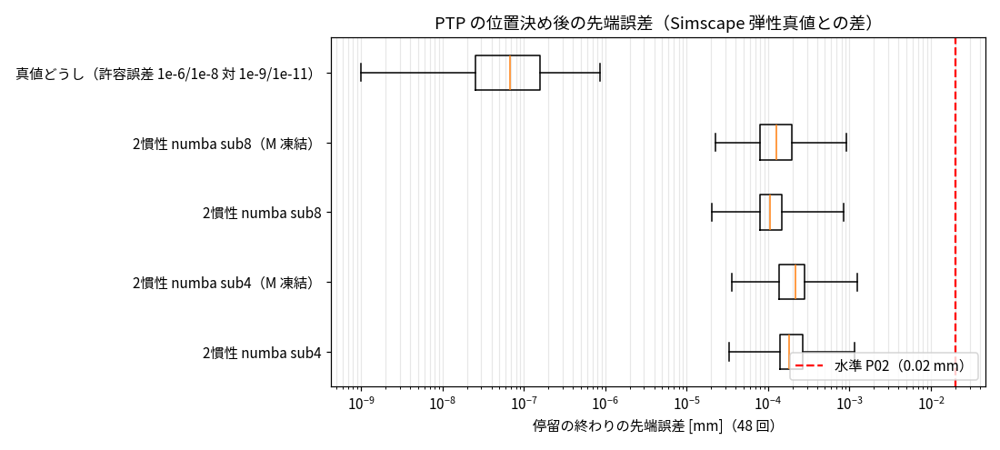

# Phase 5-3: 位置決め精度 ±0.02 mm の評価基盤（issue #93）

## 目的（#91 の対話で置き直し）
手先の繰り返し精度 ±0.02 mm が必要な場合に、実時間より速く計算できる手法を探す。本 issue は評価基盤（P-bench）、真値の数値精度の確認、2 慣性解析の到達点。

## P-bench v1（水準 P02）
| 項目 | 値 |
|---|---|
| シナリオ | 弾性真値の PTP 12 本（速度 0.2/0.4/0.6/0.8 × 3 本、到達点 5、ペイロード 0 kg、PD wn 60・ζ 1、モータ側フィードバック）。`tools/sa_export_ptp_el.m` → `data/export/ptp_el.h5` |
| 位置決め | 各到達点の 0.2 s 停留（参照速度が全軸 0）の終わり。12 本 × 4 回 = 48 回 |
| 指標 | 先端位置（フランジから 0.1 m 先、`python/sa_nsm/kinematics.py`）の、モデルと真値の差 [mm]。停留の最後 50 ms の最大も併記 |
| 判定 | 48 回すべてで ≤ 0.02 mm |
| モデルの実行 | 真値の初期状態から閉ループ（PD はモータ側、iters=1）で全長（`python/eval_ptp_pos.py`）。集計 `python/summarize_ptp.py` |

順運動学の確認: J1 軸から手首中心（J5 原点）までの水平距離の最大は 0.9011 m（仕様のアーム長 901 mm と一致）。関節 6 軸が最悪の向きに 0.01° ずれたときの先端誤差は中央値 0.283 mm（95% 点 0.343 mm）。Phase 4-8 の記録（0.23 mm）より約 2 割大きい（当時のスクリプトが残っておらず差の原因は未確認）。この換算で 0.02 mm ≈ 関節 0.0007°。

## 結果

| モデル | 停留の終わり 中央値[mm] | 最大[mm] | 最後 50 ms の最大[mm] | 1 ms あたり計算時間[ms] | 水準 P02 |
|---|---|---|---|---|---|
| 2 慣性解析 numba sub8 | 1.1e-4 | 8.5e-4 | 1.1e-3 | 1.50 | ○ |
| 2 慣性解析 numba sub8（M 凍結） | 1.3e-4 | 9.2e-4 | 1.2e-3 | 0.155 | ○ |
| 2 慣性解析 numba sub4 | 1.8e-4 | 1.2e-3 | 1.5e-3 | 0.861 | ○ |
| 2 慣性解析 numba sub4（M 凍結） | 2.2e-4 | 1.2e-3 | 1.6e-3 | 0.128 | ○ |
| 真値どうし（許容誤差 1e-6/1e-8 対 1e-9/1e-11） | 6.8e-8 | 8.6e-7 | 1.1e-6 | — | ○ |

- **真値の数値精度は十分**: ode15s の許容誤差を 1000 倍厳しくしても、位置決め後の先端の差は最大 8.6e-7 mm（0.02 mm の 2 万分の 1）。全時刻の関節角の差も最大 1.5e-6°。
- **2 慣性解析は全方式で水準 P02 を満たす**: 最速の sub4・M 凍結（1 ms あたり 0.128 ms、実時間の約 8 倍速い）でも最大 0.0012 mm（基準の 1/16）。
- 参考: 真値の、目標角に対する先端の残差（PD の定常偏差）は中央値 2.4 mm、最大 4.7 mm。位置決め後の位置は、重力・摩擦と PD の釣り合い（定常偏差）で決まる。

## 読み取り
1. 真値と同じ式・同じパラメータなら、最速の解析（numba、sub4、M 凍結）で「±0.02 mm を実時間より速く」は満たせる。NN は不要。
2. ただしこれは**真値とモデルのパラメータが同一**という条件での上限。位置決め後の位置は PD の定常偏差（2〜5 mm）で決まり、これは重力・摩擦と PD ゲインの釣り合い。摩擦や質量のわずかな誤差（例えば 1%）がそのまま数十 µm の誤差になり得る。#81 のパラメータ感度（摩擦・質量 ±10〜30%）の結果からは、実機相当の条件では ±0.02 mm に対しパラメータの精度が支配的になると見込む（未測定）。

## 限界
- パラメータ誤差のない条件（同じ式・同じ値）。実機ではモデル化誤差・同定誤差が入る。
- ペイロード 0 kg、既定ゲイン、停留 0.2 s のみ。
- 閉ループ評価の Python ループ（torch の PD 計算）の時間は含めていない（プラント 1 ステップの時間で比較。#91）。

## 次の候補
1. 位置決め誤差のパラメータ感度: 摩擦・質量・k・c を ±1/3/10% ずらして、P02 を満たす許容誤差を求める（実機での同定精度の要求になる）
2. 真値に「モデルの式にない効果」を入れた条件での評価（NN・同定が要る状況の作成）
3. ペイロード・ゲインを変えた位置決め
