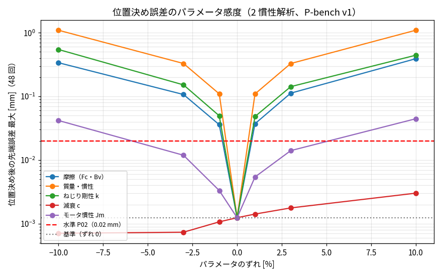

# Phase 5-4: 位置決め誤差（P02）のパラメータ感度と許容誤差（issue #95）

## 方法
- numba 版 2 慣性解析（サブステップ 4・M 凍結、1 ms あたり 0.128 ms）に、パラメータ倍率を与える（`TwoMassNB(scale=…)`。真値は変えない）。
- パラメータ: 摩擦（Fc・Bv を同率）、質量・慣性（全リンク）、ねじり剛性 k、減衰 c、モータ慣性 Jm。各 ×0.9 / 0.97 / 0.99 / 1.01 / 1.03 / 1.1（一つずつ）。
- P-bench v1（PTP 12 本 × 位置決め 4 回、停留の終わりの先端の差、#93）。`eval_ptp_pos.py --perturb`、集計 `summarize_p02_sens.py`。

## 結果
位置決め 48 回（P-bench v1）の停留の終わりの先端誤差の **最大** [mm]（括弧内は中央値）。モデルは numba 2 慣性解析（サブステップ 4・M 凍結）。基準（倍率 1）: 最大 0.0012、中央値 0.0002。水準 P02 は ≤ 0.02 mm。

| パラメータ | ×0.9 | ×0.97 | ×0.99 | ×1.01 | ×1.03 | ×1.1 | 許容誤差の目安 |
|---|---|---|---|---|---|---|---|
| 摩擦（Fc・Bv） | 0.338（0.154） × | 0.107（0.050） × | 0.036（0.017） × | 0.037（0.018） × | 0.112（0.054） × | 0.391（0.191） × | ±0.54% |
| 質量・慣性 | 1.095（0.571） × | 0.329（0.171） × | 0.110（0.057） × | 0.109（0.057） × | 0.328（0.172） × | 1.094（0.572） × | ±0.18% |
| ねじり剛性 k | 0.546（0.259） × | 0.152（0.072） × | 0.050（0.023） × | 0.048（0.023） × | 0.142（0.067） × | 0.443（0.210） × | ±0.4% |
| 減衰 c | 0.001（0.000） | 0.001（0.000） | 0.001（0.000） | 0.001（0.000） | 0.002（0.000） | 0.003（0.000） | ±14% |
| モータ慣性 Jm | 0.042（0.004） × | 0.012（0.001） | 0.003（0.001） | 0.005（0.000） | 0.014（0.001） | 0.045（0.004） × | ±3.7% |

許容誤差の目安: ±1% のときの最大誤差から、誤差がずれに比例するとして 0.02 mm になるずれを外挿した値（各パラメータ単独）。

## 読み取り
1. **位置決め誤差は、静的な釣り合いに効くパラメータで決まる**: 質量（±1% で 0.11 mm）、ねじり剛性 k（±1% で 0.05 mm）、摩擦（±1% で 0.036 mm）。いずれも ±1% で P02（0.02 mm）を外れる。停留中は PD（モータ側）と重力・摩擦が釣り合い、リンク側の位置はモータ側の位置からねじれ角 θ = (重力 + 摩擦) / k だけずれるため、これらの誤差がそのまま先端の誤差になる。
2. **動的なパラメータはほとんど効かない**: 減衰 c は ±10% でも 0.003 mm、モータ慣性 Jm は ±3% で 0.014 mm（±10% で 0.045 mm）。
3. **許容誤差の目安**（単独、±1% からの比例外挿）: 質量 ±0.18%、k ±0.4%、摩擦 ±0.5%、Jm ±3.7%、c ±14%。複数が同時にずれれば、さらに厳しい。
4. **±0.02 mm の課題は「計算の速さ」ではなく「静的パラメータの精度」**: 速さは解析（numba）で十分（#91・#93）。真値と 0.2〜0.5% で一致する重力（質量・重心）、減速機の剛性、摩擦を、どうやって得るか（同定、データからの補正）が本題になる。

## 限界
- 一因子ずつ。摩擦は Fc・Bv 同率、質量は全リンク同率（重心位置の誤差は未評価）。
- ペイロード 0 kg、既定ゲイン、停留 0.2 s。
- 実機ではリンク側の角度は直接測れない（モータ側エンコーダのみ）。真値のリンク側角度で評価している。

## 次の候補
1. **静的パラメータの同定精度**: 停留（静止）のデータから、重力（質量・重心）・k・摩擦を最小二乗で同定し、測定ノイズ・分解能のもとでどこまで 0.2〜0.5% に迫れるか。リンク側を測れる場合（外部計測）と測れない場合（モータ側のみ）を分ける。
2. **データ駆動の静的補正**: 解析モデルの位置決め後の位置に、データから学んだ静的なずれ（姿勢・ペイロードの関数）を足す。NN でも多項式でもよい（計算は位置決め後の 1 回だけで速度に影響しない）。
3. 要求の見直し: ±0.02 mm を「位置決め後の位置」ではなく「繰り返しの再現性（同じ動作の差）」に読み替えると、静的な偏りは打ち消される。用途に合わせて定義を確認する。
