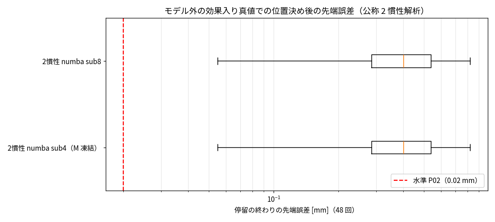

# Phase 5-5: モデル外の効果を入れた真値と公称 2 慣性解析の差（issue #97）

## 目的
ハイブリッド（物理 + データからの補正）の価値を確かめるため（#95 後の対話で決定）、真値に解析モデルの式にない効果を入れる。比較の枠組み（以後の issue）: ① 物理（公称）／② 物理（同定）／③ 純 NN／④ ハイブリッド（② + 補正）。価値は ④ が ② より良いことで示す。本 issue は真値の構築と ①。

## 入れた効果（`opts.unmodeled`、既定値は `saUnmodeledDefaults`）
| 効果 | 式 | 既定値 | 実装 |
|---|---|---|---|
| 非線形剛性（硬化ばね） | τs = k·θ·(1 + a·(θ/θr)²) | a = 0.3、θr = 0.005 rad（θ = 2 mrad で +5%、5 mrad で +30%） | Simscape 言語の部品 `src/plant/ssc/+saSsc/nl_spring.ssc` を線形ばねの代わりに置く（`saUnmodeledElastic` → `addSaElasticArmature`） |
| Stribeck 摩擦 | τst = Fs·exp(−(ω/vs)²)·tanh(ω/ε)（運動を妨げる向き、関節＝リンク側） | Fs = 0.3·Fc、vs = 2ε | 物理信号ブロック（`addSaUnmodeled`） |

検証（1.2 s のステップ、軸 2）: 非線形剛性の静的ねじれ角は理論予測と一致（[1.78, 2.10] mrad 対 予測 [1.78, 2.10]）。

### 実装上の問題と対処
1. センサ＋トルク源で非線形ばねを組むと符号が逆になり、Simulink の代数ループも出た → Simscape 言語の部品にした。
2. 部品を線形ばねと並列に置くと、ねじれ角の状態が重複して代数ループ → ばね全体を部品に置き換えた。
3. それでも、非線形ばねがあると Simulink の PD（モータ側フィードバック）と Simscape の間で代数ループと判定され、計算が約 4.5 倍遅くなった（5 s の PTP で 263 s 対 59 s）。→ `opts.unmodeled` のときは、**PD のフィードバックと飽和を Simscape の物理信号の中で組む**（`buildSaClosedLoop` の `pdToPhysical`）。式は同じで、元の真値と q の差は最大 6e-6°、トルクの差は最大 1.6e-4 N·m（効果なしで比較）。計算は元の約 2 倍。
4. **真値の数値精度**: Stribeck 摩擦があると、止まる位置がソルバの許容誤差に敏感になった。既定（RelTol 1e-6・AbsTol 1e-8）と 1e-9/1e-11 の差は、位置決め 1 回で 0.0075 mm（他は 1e-4 mm 以下）。RelTol 1e-7・AbsTol 1e-9 にすると 1e-9/1e-11 との差は最大 0.0011 mm（0.02 mm の 5%、2 本 8 回で確認）で、計算時間はほぼ変わらない。**新しい真値は RelTol 1e-7・AbsTol 1e-9 で作る。**

## 結果（P-bench v1、新しい真値 `data/export/ptp_elum_m{1..4}.h5`）

| モデル（公称パラメータ） | 停留の終わり 中央値[mm] | 最大[mm] | 水準 P02 |
|---|---|---|---|
| 2 慣性解析 numba sub4（M 凍結） | 0.403 | 0.822 | × |
| 2 慣性解析 numba sub8 | 0.403 | 0.822 | × |

- 公称の解析モデルの位置決め誤差は中央値 0.40 mm、最大 0.82 mm（P02 の 20〜40 倍）。効果を入れる前（同じ式）は最大 0.0012 mm だった。
- sub4・M 凍結と sub8 の差はない（誤差はモデルの式の違いで決まり、積分の誤差は無視できる）。

## 読み取り
1. モデル外の効果（非線形剛性・Stribeck）で、公称の解析は P02 を大きく外れる。ハイブリッドを試す状況ができた。
2. 次は ② 同定: 同じ式（線形ばね・クーロン＋粘性摩擦）のまま、データから k・摩擦・質量を最小二乗で合わせて、どこまで下がるか。② で足りなければ ④（補正）へ。

## 限界
- 効果の大きさ（a = 0.3、θr = 5 mrad、Fs = 0.3·Fc、vs = 2ε）は仮の値で、実機の値ではない。
- 誤差の内訳（非線形剛性と Stribeck のどちらが支配的か）は未分解。
- 新しい真値での学習・同定用データはまだない（次の issue で作る）。真値の生成は元の約 2〜4 倍遅い（速度 0.2 の PTP で 1 本 20〜25 分）。
- 代数ループ対策で PD を物理信号の中に移したため、`opts.unmodeled` のモデルでは Kp・Kd の set_param がフィードバックに効かない（構築時の値で固定）。ゲインを変える評価（G-bench）には作り直しが要る。
