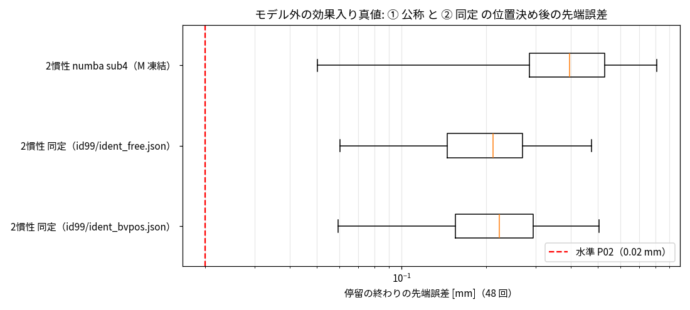

# Phase 5-6: ② 2 慣性解析のパラメータ同定（モデル外の効果入り真値）（issue #99）

## 不具合の発見と修正（#97 の訂正）
- 同定の途中で、手首のねじれ角がトルクと釣り合っていないことに気づいた（保持中、軸 5 で θ = −8.4 mrad、τ = −0.37 N·m。線形ばねなら −10.7 N·m）。
- 原因: 非線形ばねの部品（`nl_spring.ssc`）のねじれ角の状態の優先度を、#97 の代数ループ調査中に `priority.high` から `priority.none` に変えていた。初期化で状態に任意の値が入り、ばねの中立点がずれた（手首で数 mrad）。
- 修正: `priority.high` に戻した（代数ループは PD を物理信号の中に移したことで既に解消済み）。保持で確認: 非線形ばねのみで手首 θ = [0.33, 1.86, −1.05] mrad（効果なしは [0.36, 2.01, −1.10]、硬化の分だけ小さい）、Stribeck のみで k·θ と τ が一致（軸 5 で 3.04 N·m）。
- P-bench（PTP 12 本）と同定用データを作り直した（旧データは `data/export/old_prio_none/`）。新旧の P-bench の真値の差は q で最大 0.034°。修正後の真値の数値精度も確認した: ptp_v80_001 を RelTol 1e-9・AbsTol 1e-11 で計算し直すと、位置決め 4 回の先端の差は最大 0.0013 mm（P02 の 7%）。
- **#97 の結果の訂正**: ① 公称の位置決め誤差は 中央値 0.403 → **0.397 mm**、最大 0.822 → **0.812 mm**（結論は変わらない）。

## 方法
- 同定用データ（P-bench とは別のシナリオ、RelTol 1e-7・AbsTol 1e-9、`tools/sa_export_closed_um.m`）: PTP 8 本（新しいシード、速度 0.3/0.5/0.7/0.9 × 2）＋ 姿勢保持（外乱あり）19 本（36 本の予定を、生成が 1 本約 15 分と遅いため途中で打ち切り）。実印加トルクも出力。8 kHz を 2 kHz に間引いて約 35 万行。
- 同定（`python/identify_el.py`、最小二乗）。測定は q, dq, qm, dqm, τ がすべて得られる最良の場合。加速度は角速度の中心差分。
  - モータ側（軸ごと）: τ = Jm·ddqm + k·θ + c·dθ
  - リンク側（全軸まとめて）: τs = s·(M·ddq + g + b) + Bv·dq + Fc·tanh(dq/ε)、τs = τ − Jm·ddqm、s は質量倍率（全軸共通）
  - Bv を 0 以上に制約した版も作った（`--bv-nonneg`）。
- 同定したパラメータ（公称に対する倍率）を numba 2 慣性解析（sub4・M 凍結）に与えて P-bench v1（`eval_ptp_pos.py --scale-json`）。

## 同定結果（公称に対する倍率）
| パラメータ | 軸 1 | 軸 2 | 軸 3 | 軸 4 | 軸 5 | 軸 6 |
|---|---|---|---|---|---|---|
| k | 1.064 | 1.118 | 1.106 | 1.117 | 1.110 | 1.146 |
| c | 0.971 | 0.960 | 0.991 | 0.805 | 0.958 | 0.834 |
| Jm | 1.020 | 1.006 | 0.959 | 1.045 | 1.017 | 1.062 |
| Fc | 1.063 | 1.037 | 1.068 | 1.132 | 1.170 | 1.131 |
| Bv | 0.51 | 0.29 | 0.12 | −0.66 | −2.21 | −0.37 |

質量倍率 0.999（真値に質量の誤差は入れていないので正しい）。k は硬化ばねを平均して 6〜15% 硬い線形ばねとして、Fc・Bv は Stribeck 摩擦を「クーロンを大きく・粘性を小さく（手首は負）」として取り込んでいる。モータ側の残差 RMS は腕で 1〜3.8 N·m（線形の式で表せない非線形剛性の分）、手首で約 0.1 N·m。

## 結果（P-bench v1）

| モデル | 停留の終わり 中央値[mm] | 最大[mm] | 水準 P02 |
|---|---|---|---|
| ① 公称 | 0.397 | 0.812 | × |
| ② 同定（制約なし） | 0.211 | 0.474 | × |
| ② 同定（Bv ≥ 0） | 0.222 | 0.506 | × |

停留の終わりの関節角誤差（中央値、度）: ① 公称 腕 0.011〜0.014°・手首 0.07〜0.17°、② 同定 腕 0.003〜0.011°・手首 0.03〜0.07°。先端誤差には腕（軸 1〜3）が効く。

## 読み取り
1. 同定で誤差はほぼ半分になった（最大 0.81 → 0.47 mm）が、P02（0.02 mm）の約 10〜25 倍が残る。**同じ式のままの同定では、モデル外の効果（非線形剛性・Stribeck）を吸収しきれない。**
2. 同定値は「効果を平均した線形の値」で、姿勢・速度・負荷で変わる部分は残る（モータ側の残差 RMS 1〜4 N·m）。
3. これで ④ ハイブリッド（② ＋ データからの補正）を試す前提がそろった。② を強い基準線として、④ がこれを明確に下回るかを見る。

## 限界
- 測定は最良の場合（リンク側の角度も使う）。実機のモータ側のみの条件は未評価。
- 姿勢保持は 19 本（予定の約半分）。ペイロード 0 kg のみ。
- `eval_ptp_pos.py` の `joint_end_deg` は #93〜#99 の出力では実は rad だった（本 issue で度に修正。集計には使っていない）。
