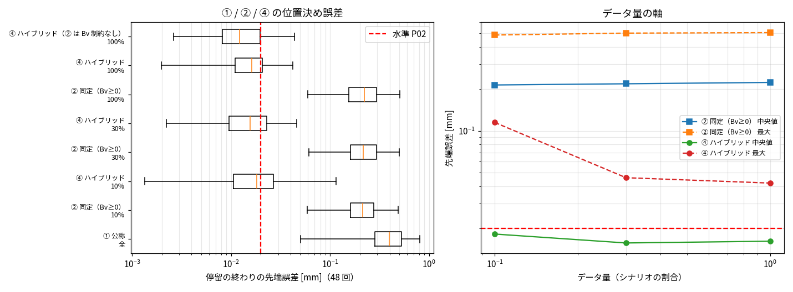

# Phase 5-7: ④ ハイブリッド（同定済み 2 慣性解析 + 残差トルク NN）（issue #101）

## 方法
- 土台: ② 同定（#99、`identify_el.py`）。データ量の軸で負の粘性摩擦が発散を起こしたため（データ 10% で手首 Bv が −11 倍、P-bench 48 回中 44 回が発散）、**Bv ≥ 0 の制約つきに統一**した。
- 残差トルク NN（`python/fit_residual_el.py`）: 同定と同じ測定（q, dq, qm, dqm, τ）から、同定済みの式で説明できないトルクを軸ごとに計算して**直接回帰**する（#85 の 1 ステップ状態損失ではない）。
  - モータ側の残差 r_m = τ − (Jm·ddqm + k·θ + c·dθ) → ばねの非線形分 Δs（モデルで τs に足す）
  - リンク側の残差 r_l = τs − (s·(M·ddq + g + b) + Bv·dq + Fc·tanh(dq/ε)) → 摩擦の非線形分 Δf（モデルで摩擦に足す）
  - 軸ごとの MLP（入力 [θ_i, dθ_i, dq_i]、2 × 32、tanh、出力 [Δs_i, Δf_i]）。Adam 4000 反復。
- 組み込み: numba の 2 慣性解析（`twomass_nb.py`、サブステップ 4・M 凍結）の右辺で、各段ごとに MLP を評価（`residual=` の npz）。
- 評価: P-bench v1（モデル外の効果入り真値、#99 で修正済み）。データ量は同定・残差学習に使うシナリオの割合（PTP 8 本＋保持 19 本から無作為に 10% / 30% / 100%。② と ④ は同じデータ）。

残差の当てはまり（検証 10%、データ 100%）: モータ側 RMS 2.8 → 0.36（軸 1）、3.8 → 0.33（軸 2）、手首 0.1 → 0.006〜0.015 N·m。リンク側 2.2 → 0.23（軸 1）、手首 0.2〜0.26 → 0.009〜0.016 N·m。

## 結果

位置決め 48 回（P-bench v1、モデル外の効果入り真値）の停留の終わりの先端誤差。データ量 = 同定・残差学習に使うシナリオの割合（PTP 8 本＋保持 19 本の中から無作為）。

| モデル | データ量 | 中央値[mm] | 最大[mm] | ≤ 0.02 mm の割合 | 1 ms あたり計算時間[ms] | 水準 P02 |
|---|---|---|---|---|---|---|
| ① 公称 | 全 | 0.3974 | 0.8122 | 0% | 0.128 | × |
| ② 同定（Bv≥0） | 10% | 0.2132 | 0.4864 | 0% | 0.141 | × |
| ④ ハイブリッド | 10% | 0.0182 | 0.1148 | 56% | 0.301 | × |
| ② 同定（Bv≥0） | 30% | 0.2175 | 0.5020 | 0% | 0.141 | × |
| ④ ハイブリッド | 30% | 0.0157 | 0.0461 | 65% | 0.301 | × |
| ② 同定（Bv≥0） | 100% | 0.2224 | 0.5061 | 0% | 0.141 | × |
| ④ ハイブリッド | 100% | 0.0162 | 0.0422 | 67% | 0.301 | × |
| ④ ハイブリッド（② は Bv 制約なし） | 100% | 0.0122 | 0.0436 | 79% | 0.301 | × |

計算時間は numba（サブステップ 4・M 凍結）、逐次 B=1、1 スレッド。④ は残差 NN（軸ごとの 2×32 tanh）を各段で評価する分が増える。

外れた位置決め（④、② は Bv 制約なし・100%）の内訳: 0.02 mm を超えた回は、ほぼ手首（特に軸 4、関節誤差 最大 0.014°）による。腕（軸 1〜3）の関節誤差は約 0.0002° で十分小さい。

## 読み取り
1. **④ は ② を明確に下回る**: 中央値 0.22 → 0.016 mm（約 1/14）、最大 0.51 → 0.042 mm（約 1/12）。0.02 mm 以下の割合は 0% → 67%。ハイブリッドの価値（同じ式の同定では届かない精度）が示せた。
2. **P02（48 回すべて ≤ 0.02 mm）は未達**: 最大 0.042 mm（基準の約 2 倍）。残りはほぼ手首（止まり際の低速摩擦）。
3. **データ量**: ② はデータ量でほとんど変わらない（式の限界）。④ は 10% でも中央値 0.018 mm と大きく改善するが、最大は 0.115 mm と悪く、30% 以上で 0.046 → 0.042 mm に収まる。
4. **速さ**: 1 ms あたり 0.30 ms（② の約 2 倍、実時間の約 3 倍速い）。逐次で実時間より速いという条件は保っている。
5. ② の Bv を制約しない方が ④ の中央値は良かった（0.012 mm、79%）が、データが少ないと発散するので、制約つきを基本とした。

## 限界
- ③ 純 NN は今回比べていない（#73 で弾性真値に対し手首で発散。モデル外の効果入りの真値では未評価）。
- 外挿（学習にない姿勢・ペイロード・速度）は未評価。ペイロード 0 kg のみ。
- 測定は最良の場合（リンク側の角度も使う）。
- 残差 NN は軸ごとに独立（軸間の連成の残差は表せない）。手首の止まり際の摩擦は、入力 [θ, dθ, dq] では捉えきれていない可能性。
- seed 1 つ。

## 次の候補
1. 手首の残りの改善: 低速域のデータを増やす（保持の残り 17 本）、入力に加速度や前の速度を加える、手首だけ幅を増やす
2. ③ 純 NN との比較（同じデータ量）と、外挿（未知の姿勢・速度）の評価
3. モータ側のみの測定条件（実機に近い）での ② と ④
