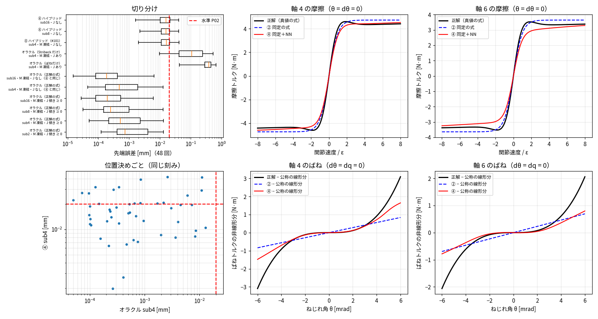

# Phase 5-8: ④ の残る誤差の切り分け（issue #103）

#101 の ④ ハイブリッドは P02 未達（最大 0.042 mm）。原因が**学習（NN の表す形）**か**計算方法（刻み・M 凍結・ヤコビアン）**かを切り分けた。

## 方法
- オラクル: 公称パラメータの 2 慣性解析に、真値に入れたモデル外の効果の式（硬化ばね τ = kθ(1 + aθ²/θr²)、Stribeck Fs·exp(−(ω/vs)²)·tanh(ω/ε)）をそのまま足す（`twomass_nb.py` の `oracle=`）。学習誤差 0 の ④ に当たる。
- 計算の細かさ: サブステップ 2/4/8/16（M 凍結）、④ はサブステップ 8/16（M 凍結なし）。
- ヤコビアン: 効果の微分を入れる（Stribeck は傾き ≥ 0 の部分だけ）／入れない（④ と同じ扱い）。
- 評価: P-bench v1（#101 と同じ 48 回）。

## 結果

位置決め 48 回（P-bench v1、モデル外の効果入り真値）の停留の終わりの先端誤差。オラクル = 公称パラメータ＋真値に入れた硬化ばね・Stribeck 摩擦の式そのもの。④ は #101 の Bv≥0・データ 100% のモデル。

| モデル | 計算の細かさ | 効果の微分のヤコビアン | 中央値[mm] | 最大[mm] | ≤ 0.02 mm の割合 | 1 ms あたり計算時間[ms] | 水準 P02 |
|---|---|---|---|---|---|---|---|
| オラクル（正解の式） | sub2・M 凍結 | 傾き ≥ 0 | 0.0007 | 0.0130 | 100% | 0.131 | ○ |
| オラクル（正解の式） | sub4・M 凍結 | 傾き ≥ 0 | 0.0005 | 0.0129 | 100% | 0.154 | ○ |
| オラクル（正解の式） | sub8・M 凍結 | 傾き ≥ 0 | 0.0003 | 0.0129 | 100% | 0.222 | ○ |
| オラクル（正解の式） | sub16・M 凍結 | 傾き ≥ 0 | 0.0002 | 0.0061 | 100% | 0.348 | ○ |
| オラクル（正解の式） | sub4・M 凍結 | なし（④ と同じ） | 0.0005 | 0.0128 | 100% | — | ○ |
| オラクル（正解の式） | sub16・M 凍結 | なし（④ と同じ） | 0.0002 | 0.0064 | 100% | — | ○ |
| オラクル（ばねだけ） | sub4・M 凍結 | あり | 0.3844 | 0.6704 | 0% | — | × |
| オラクル（Stribeck だけ） | sub4・M 凍結 | あり | 0.1093 | 0.5373 | 6% | — | × |
| ④ ハイブリッド（#101） | sub4・M 凍結 | なし | 0.0162 | 0.0422 | 67% | 0.308 | × |
| ④ ハイブリッド | sub8 | なし | 0.0158 | 0.0414 | 69% | 2.116 | × |
| ④ ハイブリッド | sub16 | なし | 0.0158 | 0.0412 | 67% | — | × |

参考: Stribeck の負の傾きもヤコビアンに入れると sub8 で 48 回中 24 回が発散（NaN）した（W = I − γhJ が特異に近づく）。以後は傾き ≥ 0 の部分だけを入れる。
計算時間は numba、逐次 B=1、1 スレッド、このマシンで測った値。

## 読み取り
1. **計算方法は原因ではない。** 正解の式ならサブステップ 2（M 凍結、1 ms あたり 0.13 ms）でも 48 回すべて ≤ 0.013 mm。効果の微分をヤコビアンに入れなくても同じ（④ と同じ扱いで問題ない）。④ は刻みを 4 → 16 にしても最大 0.042 → 0.041 mm で変わらない。
2. **原因は NN の学んだ形。** 図の右上（摩擦）・右下（ばね）で、④（赤）は正解（黒）に近づいているが、
   - 摩擦: Stribeck の山（|dq| ≈ 1〜2ε）を表せていない。軸 6 では高速側の摩擦も 0.1〜0.2 N·m 低い（入力の他の成分を 0 にした断面なので目安）。
   - ばね: ねじれ角 ±3.5 mrad 付近より外で非線形分が小さい（学習データの θ は 99% が ±3.6〜4 mrad 内。外側は外挿）。
3. **両方の効果を表す必要がある。** 片方だけ正解でも中央値 0.11〜0.38 mm。
4. **実装の注意**: Stribeck の負の傾きをヤコビアンに入れると、J に正の固有値 λ ができ、γhλ ≈ 1 で W = I − γhJ が特異になって発散する（sub8 で 24/48 回 NaN）。傾き ≥ 0 の部分だけ入れる。

## 次（改善案 B）
- 入力の尺度: dq を ε で割る（今は全データの標準偏差で割っており、Stribeck の幅が NN から見て狭い）、tanh(dq/ε) を入力に足す
- 低速域の重み付け、ねじれ角の大きいデータ（大きな負荷・加速度）の追加
- 目標: オラクルと同じ最大 ≈ 0.013 mm。計算時間はオラクル sub2 が 0.13 ms、④ sub4 が 0.30 ms（NN の評価分）。
