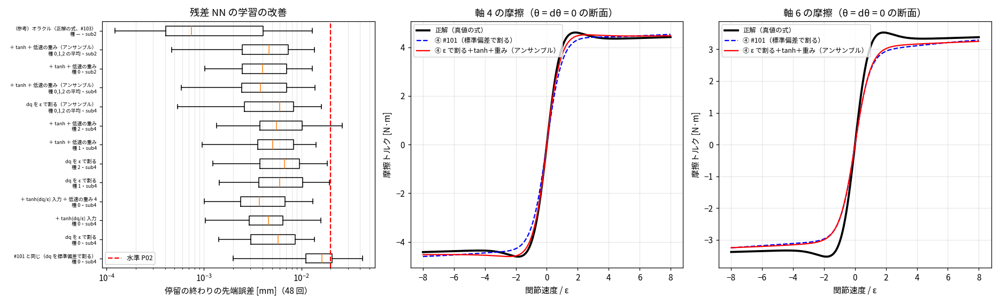

# Phase 5-9: 残差 NN の学習の改善（issue #105）

#103 で ④ の残る誤差は NN の学んだ形（Stribeck の山など）と分かった。学習の入力の尺度・重み・種・アンサンブルを変え、P-bench v1 で比べた。

## 方法（`fit_residual_el.py` の追加オプション）
- `--dq-eps`: 入力の関節速度を ε（摩擦の tanh の幅）で割る。#101 は全データの標準偏差で割っており、Stribeck の効く |dq| ≈ 1〜2ε が NN から見て狭かった
- `--tanh-feat`: 4 番目の入力 tanh(dq/ε)
- `--wlow 4`: 低速の行に重み 1 + 4·exp(−(dq/4ε)²)
- 種 0/1/2、アンサンブル（`ensemble_residual.py`: 3 つの NN を 1 つの MLP にまとめて出力を平均）
- 土台は #101 と同じ ② 同定（Bv≥0、データ 100%）。学習データ（同定用 PTP 8 本＋保持 19 本）と P-bench は別の軌道

## 結果

位置決め 48 回（P-bench v1、モデル外の効果入り真値）の停留の終わりの先端誤差。④ = ② 同定（Bv≥0、データ 100%）＋ 残差トルク NN（軸ごと 2×32 tanh）。すべて M 凍結。

| ④ の残差 NN | 種 | 計算の細かさ | 中央値[mm] | 最大[mm] | ≤ 0.02 mm の割合 | 1 ms あたり計算時間[ms] | 水準 P02 |
|---|---|---|---|---|---|---|---|
| #101 と同じ（dq を標準偏差で割る） | 0 | sub4 | 0.0162 | 0.0422 | 67% | 0.310 | × |
| dq を ε で割る | 0 | sub4 | 0.0058 | 0.0135 | 100% | 0.311 | ○ |
| ＋ tanh(dq/ε) 入力 | 0 | sub4 | 0.0046 | 0.0158 | 100% | 0.362 | ○ |
| ＋ tanh(dq/ε) 入力 ＋ 低速の重み 4 | 0 | sub4 | 0.0037 | 0.0131 | 100% | 0.349 | ○ |
| dq を ε で割る | 1 | sub4 | 0.0060 | 0.0194 | 100% | — | ○ |
| dq を ε で割る | 2 | sub4 | 0.0067 | 0.0184 | 100% | — | ○ |
| ＋ tanh ＋ 低速の重み | 1 | sub4 | 0.0051 | 0.0142 | 100% | — | ○ |
| ＋ tanh ＋ 低速の重み | 2 | sub4 | 0.0056 | 0.0263 | 98% | — | × |
| dq を ε で割る（アンサンブル） | 0,1,2 の平均 | sub4 | 0.0060 | 0.0160 | 100% | 0.634 | ○ |
| ＋ tanh ＋ 低速の重み（アンサンブル） | 0,1,2 の平均 | sub4 | 0.0038 | 0.0138 | 100% | 0.780 | ○ |
| ＋ tanh ＋ 低速の重み | 0 | sub2 | 0.0040 | 0.0130 | 100% | 0.226 | ○ |
| **＋ tanh ＋ 低速の重み（アンサンブル）** | 0,1,2 の平均 | sub2 | 0.0047 | 0.0136 | 100% | 0.439 | ○ |
| （参考）オラクル（正解の式、#103） | — | sub2 | 0.0007 | 0.0130 | 100% | 0.136 | ○ |

計算時間は numba、逐次 B=1、1 スレッド、このマシンで 3 回測った最小。アンサンブルは 3 つの NN を幅 96 の 1 つの MLP にまとめ、第 2 層のブロックの外を飛ばす（`ensemble_residual.py`）。

## 読み取り
1. **効いたのは dq の尺度。** ε で割るだけで最大 0.042 → 0.0135 mm（P02 を満たす）。tanh 入力と低速の重みは主に中央値を下げる（0.0058 → 0.0037 mm）。軸 4 では Stribeck の山が表せるようになった（図中央）。
2. **単独の NN は種でばらつく。** 最大 0.013〜0.026 mm、6 本中 1 本が P02 を外れた（48 回中 1 回）。P-bench の結果で設定を選んだので、単独の結果は楽観的に読む必要がある。
3. **アンサンブル（3 つの種の平均）でばらつきが収まる。** 最大 0.0138 mm（sub4）／0.0136 mm（sub2）、48 回すべて ≤ 0.02 mm。正解の式（0.0130 mm）とほぼ同じ。
4. **刻みは sub2 で足りる**（#103 のオラクルと同じ）。推奨構成 = ④（ε で割る＋tanh＋低速の重み、3 つのアンサンブル）・sub2・M 凍結: **1 ms あたり 0.45 ms（逐次で実時間の約 2.2 倍速）で P02 を満たす**。
5. 軸 6 の摩擦は θ = dθ = 0 の断面では正解より 0.1〜0.2 N·m 低いまま（図右）。位置決め誤差には効いていないが、学習データでは高速時に θ ≠ 0 なので、この断面は学習範囲の外の可能性がある。

## 限界
- 真値に入れたモデル外の効果は 2 種類（硬化ばね・Stribeck）だけ。実機の効果（バックラッシ、温度、ヒステリシス等）は未検証
- 測定はリンク側の角度も得られる最良の場合。評価は P-bench v1 の 48 回のみ（ペイロード 0、既定ゲイン）。学習外の姿勢・速度・ペイロードへの外挿は未評価
- ③ 純 NN との比較は未実施
- 計算時間はこのマシンの 1 スレッドの値。Simscape 真値（モデル外の効果入り）の計算時間は今回測っていない
